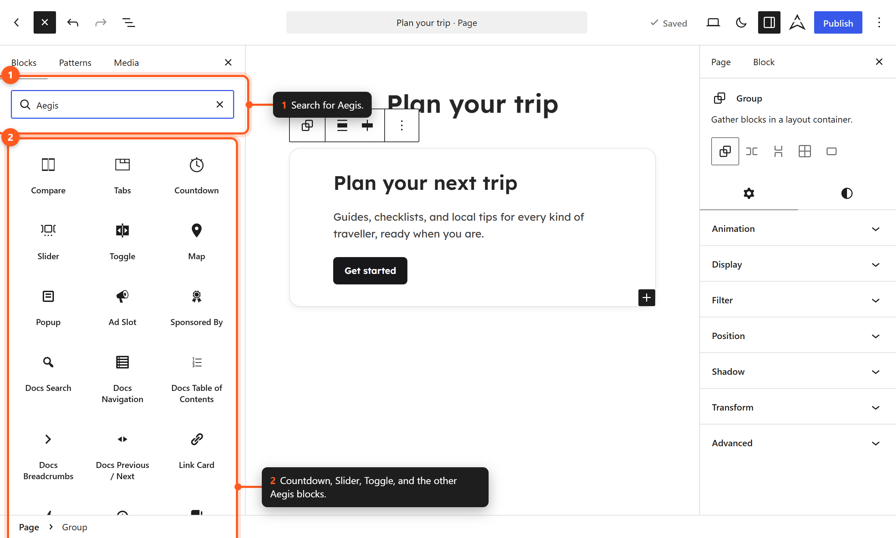

# Custom Blocks

The Aegis **theme** registers six custom blocks from `src/Blocks/`. Map and Modal require the [Aegis companion plugin](../../../../plugins/aegis/docs/blocks/custom-blocks.md). Pro adds [tabs, Compare, and block sub-features](../../../../plugins/aegis-pro/docs/features/pro-blocks.md). Compare uses the theme Image inspector (aspect ratio, height, object-fit, object-position) in addition to Pro extras at **Aegis → Blocks → Compare**.

Block feature toggles are at **Aegis → Blocks** when the plugin is active — see [Plugin Block Variations](../../../../plugins/aegis/docs/blocks/block-variations.md).

## Theme-Registered Blocks

*Search the inserter for Aegis to find the theme's blocks.*

| Block | Namespace | Documentation |
|-------|-----------|---------------|
| Countdown | `aegis/countdown` | [[countdown]] |
| Slider | `aegis/slider` | [[slider]] (includes Slide child) |
| Slide | `aegis/slide` | [[slider]] |
| Toggle | `aegis/toggle` | [[toggle]] (includes Toggle Content child) |
| Toggle Content | `aegis/toggle-content` | [[toggle]] |
| Related Posts | `aegis/related-posts` | [[related-posts]] |

## Video

Aegis does not register `aegis/video`. Use WordPress **`core/video`** — see [[core-video]].

## Plugin Blocks

| Block | Namespace | Documentation |
|-------|-----------|---------------|
| Map | `aegis/map` | [Plugin — Map](../../../../plugins/aegis/docs/blocks/map.md) |
| Modal | `aegis/modal` | [Plugin — Modals](../../../../plugins/aegis/docs/blocks/modals.md) |

> **Note:** Map and Modal require the free Aegis Plugin. Theme blocks work without the plugin when using the Aegis theme.

## Block Dependencies

| Block | Requires |
|-------|----------|
| Countdown, Slider/Slide, Toggle/Toggle Content, Related Posts | Aegis theme only (plugin extras at **Aegis → Blocks** when the plugin is active; extras imply the parent block) |
| Map, Modal | Aegis theme + Aegis Plugin |
| `core/video` enhancements | Theme framework; editor scripts need plugin; Pro stack optional |
| Compare (`aegis/image-compare`) | Aegis theme + Aegis Plugin + Aegis Pro; extras at **Aegis → Blocks → Compare** |

## Next Steps

- [[enhanced-core-blocks]] — Framework core block enhancements
- [[block-variations]] — Framework block variations
- [[block-patterns]] — Pre-built layouts using these blocks
- [Conditional Logic (Plugin)](../../../../plugins/aegis/docs/features/conditional-logic.md)
