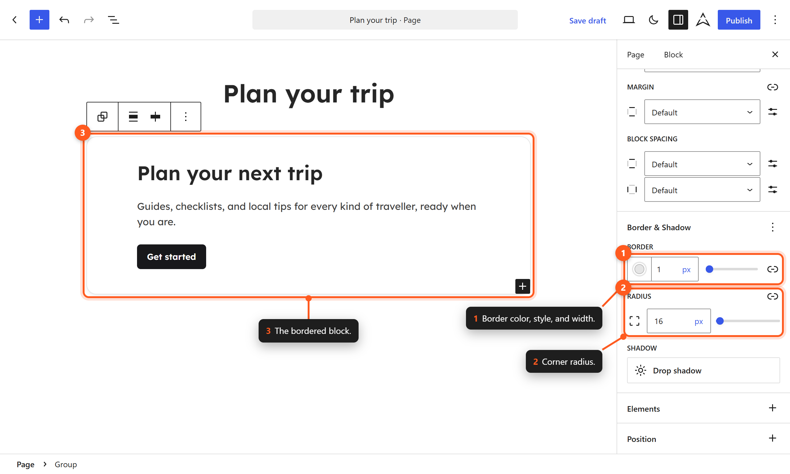

# Borders

Aegis defines a set of border tokens for consistent visual framing across blocks and components. Border properties include width, style, color, and radius.

## Default Border Values

| Property | Default Value | Description |
|----------|---------------|-------------|
| Width | 1px | Standard border thickness |
| Style | solid | Border line style |
| Color | `neutral-200` | Light gray border color |
| Radius | 6px | Corner rounding |

## Border Radius

The default border radius of 6px provides a subtle, modern rounding to elements. This value applies to:

- Cards and containers
- Buttons
- Input fields
- Image blocks with border settings enabled
- Group blocks with border enabled

### Applying Border Radius in the Editor

1. Select a block that supports border settings.
2. In the block settings sidebar, find the **Border** section.
3. Click the **Radius** control.
4. Enter a value or use the slider.
5. For individual corner control, click the unlink icon to set each corner independently.

### Common Radius Values

| Usage | Recommended Value |
|-------|-------------------|
| Cards and panels | 6px (default) |
| Buttons | 6px (default) or pill (9999px) |
| Input fields | 6px (default) |
| Avatars and circular elements | 50% |
| Subtle rounding | 4px |
| No rounding | 0px |

## Border Width

The default border width of 1px provides a clean, subtle boundary. Blocks that support borders allow you to adjust the width:

1. Select the block.
2. In the **Border** section of block settings, click the width control.
3. Enter a pixel value.

### Recommended Border Widths

| Usage | Width |
|-------|-------|
| Standard card borders | 1px |
| Emphasis borders | 2px |
| Decorative dividers | 2px–4px |
| Heavy separators | 4px–8px |

## Border Color

The default border color is `neutral-200`, a light gray that provides subtle separation without visual noise.

### Changing Border Color

1. Select a block with border support.
2. In the **Border** section, click the color swatch.
3. Choose from the preset palette or enter a custom color.

### Recommended Border Colors

| Context | Recommended Color |
|---------|-------------------|
| Default borders (light mode) | `neutral-200` |
| Active/focused elements | `primary-500` |
| Success indicators | `success-500` |
| Warning indicators | `warning-500` |
| Error indicators | `error-500` |
| Subtle separation | `neutral-100` |

## Border Style

The default border style is `solid`. Other CSS border styles are available through custom CSS:

| Style | Appearance | Usage |
|-------|------------|-------|
| `solid` | Continuous line | Default, most common |
| `dashed` | Dashed line | Placeholder areas, drop zones |
| `dotted` | Dotted line | Subtle separation, decorative |
| `none` | No border | Remove inherited borders |

## Using Borders in the Editor

### Adding a Border to a Block



*Add a border and radius from the Border & Shadow panel.*

1. Select a block (Group, Column, Image, or similar).
2. In the right sidebar, expand the **Border** section.
3. Set the **Width** (for example, 1px).
4. Set the **Color** using the color picker.
5. Optionally adjust the **Radius** for rounded corners.

### Individual Side Borders

For blocks that support it, you can set borders on individual sides:

1. In the Border section, click the unlink icon.
2. Set border properties for Top, Right, Bottom, and Left independently.
3. This allows effects like a left accent border or bottom divider.

### Example: Left Accent Border

A common design pattern uses a thick left border for emphasis:

- Left width: 4px
- Left color: `primary-500`
- Other sides: none

This creates a visual accent strip on the left edge of a quote or callout.

## CSS Custom Properties

Border tokens are available as CSS custom properties:

```css
var(--wp--custom--border--width)    /* 1px */
var(--wp--custom--border--style)    /* solid */
var(--wp--custom--border--color)    /* var(--wp--preset--color--neutral-200) */
var(--wp--custom--border--radius)   /* 6px */

/* Usage example */
.my-element {
    border: var(--wp--custom--border--width) var(--wp--custom--border--style) var(--wp--custom--border--color);
    border-radius: var(--wp--custom--border--radius);
}
```

## theme.json Configuration

Border settings are defined in `theme.json`:

```json
{
  "settings": {
    "border": {
      "color": true,
      "radius": true,
      "style": true,
      "width": true
    },
    "custom": {
      "border": {
        "width": "1px",
        "style": "solid",
        "color": "var(--wp--preset--color--neutral-200)",
        "radius": "6px"
      }
    }
  }
}
```

The border defaults are **custom tokens** in `settings.custom.border`, not a global `styles.border` rule. WordPress outputs them as `--wp--custom--border--width`, `--wp--custom--border--style`, `--wp--custom--border--color`, and `--wp--custom--border--radius`. Blocks and elements opt in by referencing them. For example, `styles.elements.button` and `core/preformatted` use `var(--wp--custom--border--radius)`.

## Borders and Dark Mode

Dark mode remaps the palette shades (a light shade swaps with its dark counterpart), so a border set to `neutral-200`, including `--wp--custom--border--color`, turns dark automatically. Borders stay visible in both color modes without extra CSS. See [[dark-mode]].

## Design Guidelines

### When to Use Borders

- **Cards** — Define card boundaries when shadows are not used.
- **Form inputs** — Indicate interactive field boundaries.
- **Tables** — Separate rows and columns.
- **Dividers** — Create horizontal or vertical separation.
- **Emphasis** — Left or top accent borders for highlighted content.

### When to Use Shadows Instead

- When you want depth rather than flat separation.
- For elevated elements (dropdowns, modals, popovers).
- When a lighter, more modern aesthetic is desired.

### Combining Borders and Shadows

Borders and shadows can work together. A common pattern is a light border combined with a subtle shadow:

```css
.card {
    border: 1px solid var(--wp--preset--color--neutral-200);
    box-shadow: var(--wp--preset--shadow--xs);
    border-radius: var(--wp--custom--border--radius);
}
```

## Next Steps

- [[shadows]] — Learn about box shadow presets.
- [[color-palette]] — Explore colors for border customization.
- [[spacing]] — Understand internal spacing (padding) for bordered elements.
- [[css-variables-reference]] — Full list of border-related custom properties.
