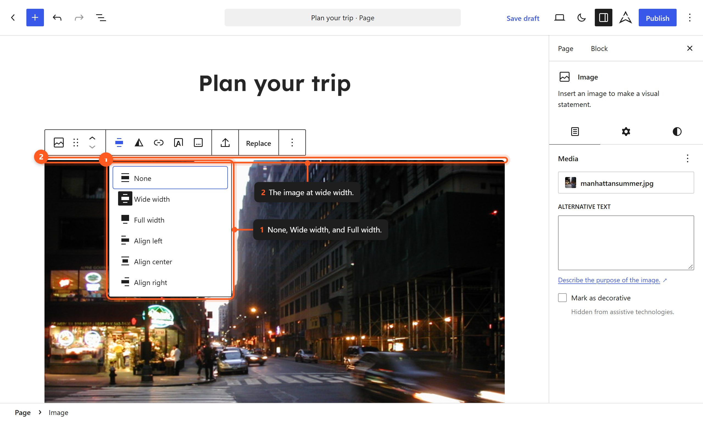
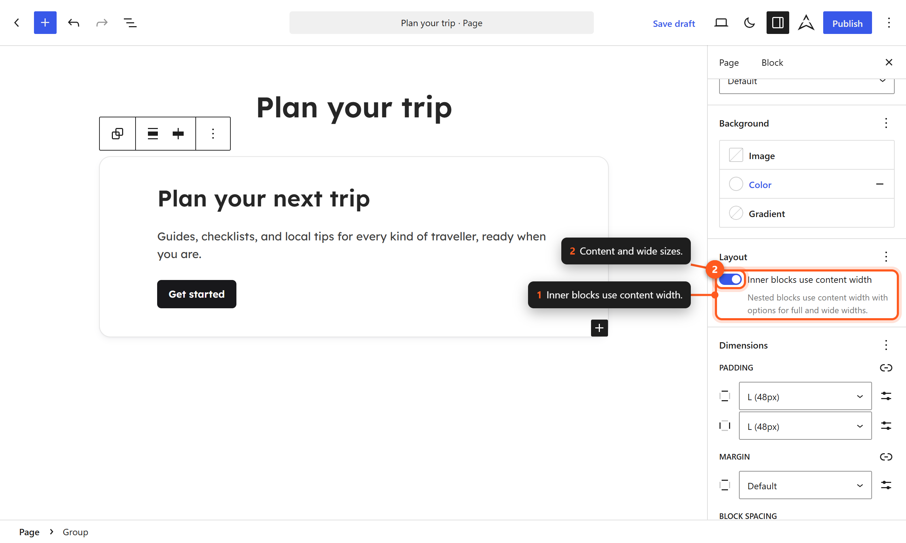

# Layout

Aegis uses a content-width system that controls how blocks align and how wide content spans across the page. The layout is defined in `theme.json` and governs content size, wide size, and alignment behavior.

## Layout Dimensions

| Setting | Value | Description |
|---------|-------|-------------|
| Content Size | 720px (max) | Maximum width for standard content blocks. |
| Wide Size | 1200px (max) | Maximum width for wide-aligned blocks. |

Both values are `min()` expressions, so on narrow screens they shrink to the viewport minus the `lg` spacing step on each side:

```text
contentSize: min(calc(100% - var(--wp--preset--spacing--lg,3rem) * 2), 720px)
wideSize:    min(calc(100% - var(--wp--preset--spacing--lg,3rem) * 2), 1200px)
```

### Content Size

The content size (720px) determines the maximum width of blocks at their default alignment. This creates a comfortable reading line length for body text and standard content.

Blocks aligned to "None" or "Default" will not exceed this width.

### Wide Size

The wide size (1200px) determines the maximum width of blocks aligned to "Wide." This allows certain elements to break out of the standard content column for visual emphasis while still maintaining some margin from the viewport edges.

### Full Width

Blocks aligned to "Full width" ignore both content and wide size constraints, spanning the entire viewport width edge to edge.

## Alignment Options

WordPress blocks support several alignment options that interact with the layout settings:



*Content, wide, and full-width alignment.*

| Alignment | Behavior | Max Width |
|-----------|----------|-----------|
| None (default) | Contained within content width | 720px |
| Wide | Breaks out to wide width | 1200px |
| Full width | Spans the entire viewport | 100vw |
| Left | Floats left within content width | — |
| Right | Floats right within content width | — |
| Center | Centered within content width | 720px |

## Configuring Layout in the Editor

### Global Layout Settings

1. Open the Site Editor (**Appearance → Editor**).
2. Click the **Styles** icon.
3. Navigate to **Layout**.
4. Adjust the **Content** width and **Wide** width values.
5. Set root-level **Padding** (the space between content and viewport edges).
6. Save your changes.

### Per-Block Layout Settings

Container blocks (Group, Columns, Cover) can override global layout:



*Override content and wide sizes on a single block.*

1. Select the container block.
2. In the block settings sidebar, find **Layout**.
3. Choose the layout type:
   - **Constrained** — Blocks inside respect content and wide width limits.
   - **Flow** — Blocks stack vertically without width constraints.
   - **Flex** — Blocks arranged using flexbox (rows or columns).
   - **Grid** — Blocks arranged in a CSS grid layout.
4. Optionally override the content width and wide width for this specific container.

## Layout Types

### Constrained Layout

The default layout type for most containers. Blocks inside are constrained to the content width unless individually aligned wider.

```
┌─────────────────────────────────────────────┐  ← Viewport
│    ┌───────────────────────────────────┐    │  ← Wide (1200px)
│    │    ┌───────────────────────┐      │    │  ← Content (720px)
│    │    │   Standard block      │      │    │
│    │    └───────────────────────┘      │    │
│    │                                    │    │
│    │  Wide-aligned block                │    │
│    └───────────────────────────────────┘    │
│                                             │
│  Full-width block                           │
└─────────────────────────────────────────────┘
```

### Flow Layout

Blocks stack vertically and fill the available width of their container. No width constraints are applied.

### Flex Layout

Enables flexbox-based layouts for horizontal or vertical arrangements:

- **Row direction** — Blocks placed side by side.
- **Column direction** — Blocks stacked vertically.
- **Justify** — Controls horizontal distribution (start, center, end, space-between).
- **Wrap** — Whether items wrap to the next line.

### Grid Layout

Enables CSS Grid-based layouts:

- Set column count or minimum column width.
- Items automatically flow into the grid.
- Useful for card layouts, galleries, and equal-height items.

## Root-Level Padding

Root padding adds space between the content and the viewport edges, preventing content from touching the screen on smaller devices:

```json
{
  "styles": {
    "spacing": {
      "padding": {
        "right": "var(--wp--preset--spacing--lg)",
        "left": "var(--wp--preset--spacing--lg)"
      }
    }
  }
}
```

The root padding is the `lg` step, which is fluid: 24px on phones, up to 48px on wide screens. See [[spacing]].

The `useRootPaddingAwareAlignments` setting ensures full-width blocks can still stretch edge to edge while content blocks respect the root padding.

### Full-Width Blocks Inside the Main Element

Templates wrap content in `main.site-main`. When that element carries root padding (`has-global-padding`), its full-width children cancel it with negative margins equal to `--wp--style--root--padding-left` and `--wp--style--root--padding-right` (`style.css`). Core does the same for `.has-global-padding > .alignfull`.

Without this rule, every nested full-width group added another layer of root padding and squeezed content on phones. The fix shipped in 1.0.1.

## Responsive Behavior

The layout system adapts to different viewport sizes:

- On narrow viewports, content blocks fill the available width minus the `lg` step on each side.
- On viewports up to about 1300px, standard blocks are constrained to 720px but wide blocks fill the viewport minus that padding.
- On wider viewports, wide-aligned blocks stop growing at 1200px.

Full-width blocks always span the entire viewport regardless of size.

## theme.json Configuration

Layout settings are defined in `theme.json`:

```json
{
  "settings": {
    "layout": {
      "contentSize": "min(calc(100% - var(--wp--preset--spacing--lg,3rem) * 2), 720px)",
      "wideSize": "min(calc(100% - var(--wp--preset--spacing--lg,3rem) * 2), 1200px)"
    },
    "useRootPaddingAwareAlignments": true
  }
}
```

## CSS Custom Properties

Layout dimensions are available as CSS custom properties:

```css
var(--wp--style--global--content-size)  /* up to 720px */
var(--wp--style--global--wide-size)     /* up to 1200px */
var(--wp--style--root--padding-left)    /* lg step */
var(--wp--style--root--padding-right)   /* lg step */
```

## Layout Best Practices

### Content Width (720px)

The 720px content width is optimized for:

- Comfortable reading (approximately 65–75 characters per line at body size).
- Standard blog posts and article content.
- Form layouts and standard page content.

### When to Use Wide Alignment

Wide alignment (1200px) works well for:

- Image galleries and portfolios.
- Multi-column feature sections.
- Tables with many columns.
- Full-width pattern sections that still need some margin.

### When to Use Full Width

Full-width alignment is appropriate for:

- Hero sections and banners.
- Map embeds.
- Footer patterns.
- Sections with background images or colors that should bleed to the edges.

## Next Steps

- [[spacing]] — Learn about the spacing scale used for padding and gaps.
- [[templates]] — See how layout settings apply to different templates.
- [[global-styles]] — Adjust layout dimensions through the Styles panel.
- [[css-variables-reference]] — Full list of layout-related custom properties.
