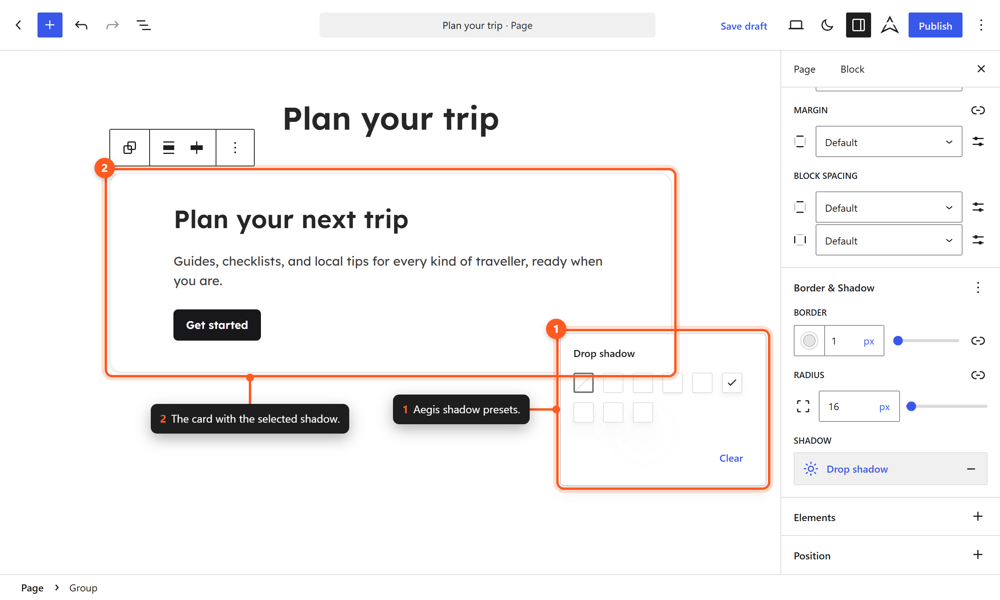

# Shadows

Aegis provides a set of 8 box shadow presets that create depth and visual hierarchy. These shadow tokens are defined in `theme.json` and available for use in the block editor and custom CSS.

## Shadow Scale

The scale runs from None through XX Small to XX Large, with increasing offset and blur:

| Slug | Name | Description |
|------|------|-------------|
| `none` | None | No shadow. Used to remove inherited shadows. |
| `xxs` | XX Small | Barely visible. Subtle lift for small elements. |
| `xs` | X Small | Light shadow. Cards and interactive elements at rest. |
| `sm` | Small | Small shadow. Buttons, inputs, and small cards. |
| `md` | Medium | Medium shadow. Standard card elevation. |
| `lg` | Large | Large shadow. Elevated panels and dropdowns. |
| `xl` | X Large | Extra large. Modal dialogs and popovers. |
| `xxl` | XX Large | Maximum elevation. Floating action elements. |

`theme.json` sets `defaultPresets` to `false`, so the WordPress default shadows are not offered.

## Shadow Values

Every layer uses one color token, `--wp--custom--box-shadow--color`. It is set in `settings.custom.boxShadow.color` to `var(--wp--preset--color--shadow)`, the palette's `shadow` entry (`rgba(107,114,128,0.07)`). Change that one token to tint or strengthen every preset at once.

| Slug | CSS Value |
|------|-----------|
| `none` | `none` |
| `xxs` | `0 1px 2px 0 var(--wp--custom--box-shadow--color)` |
| `xs` | `0 1px 2px var(--wp--custom--box-shadow--color), 0 2px 4px 0 var(--wp--custom--box-shadow--color)` |
| `sm` | `0 1px 2px 0 var(--wp--custom--box-shadow--color), 0 4px 12px -4px var(--wp--custom--box-shadow--color)` |
| `md` | `0 1px 2px 0 var(--wp--custom--box-shadow--color), 0 4px 8px var(--wp--custom--box-shadow--color)` |
| `lg` | `0 2px 4px 0 var(--wp--custom--box-shadow--color), 0 8px 24px var(--wp--custom--box-shadow--color)` |
| `xl` | `0 4px 8px -4px var(--wp--custom--box-shadow--color), 0 16px 24px -4px var(--wp--custom--box-shadow--color)` |
| `xxl` | `0 4px 8px 0 var(--wp--custom--box-shadow--color), 0 24px 48px 0 var(--wp--custom--box-shadow--color)` |

## Using Shadows in the Editor

### Applying a Shadow to a Block



*Pick a shadow preset in the Border & Shadow panel.*

1. Select a block that supports shadows (Group, Column, Image, Button, and others).
2. In the block settings sidebar, find the **Shadow** option under **Border** or **Styles**.
3. Click the shadow picker to see the preset options.
4. Select a shadow preset from the scale.
5. The shadow is applied immediately.

### Removing a Shadow

1. Select the block with the shadow applied.
2. Open the shadow picker.
3. Select **None** to remove the shadow.

## Common Shadow Usage

| Element | Recommended Shadow |
|---------|-------------------|
| Cards at rest | `xs` or `sm` |
| Cards on hover | `md` or `lg` |
| Buttons at rest | `xxs` or `xs` |
| Buttons on hover | `sm` |
| Dropdown menus | `lg` |
| Modal dialogs | `xl` |
| Floating elements | `xl` or `xxl` |
| Tooltips | `sm` |
| Navigation dropdowns | `md` or `lg` |

## CSS Custom Properties

Shadow tokens are available as CSS custom properties:

```css
var(--wp--preset--shadow--none)
var(--wp--preset--shadow--xxs)
var(--wp--preset--shadow--xs)
var(--wp--preset--shadow--sm)
var(--wp--preset--shadow--md)
var(--wp--preset--shadow--lg)
var(--wp--preset--shadow--xl)
var(--wp--preset--shadow--xxl)
```

### Example Usage in Custom CSS

```css
.my-card {
    box-shadow: var(--wp--preset--shadow--sm);
    transition: box-shadow 0.2s ease;
}

.my-card:hover {
    box-shadow: var(--wp--preset--shadow--lg);
}
```

## theme.json Configuration

Shadows are defined in `theme.json` under `settings.shadow.presets`:

```json
{
  "settings": {
    "shadow": {
      "defaultPresets": false,
      "presets": [
        { "name": "None", "slug": "none", "shadow": "none" },
        { "name": "XX Small", "slug": "xxs", "shadow": "0 1px 2px 0 var(--wp--custom--box-shadow--color)" },
        { "name": "X Small", "slug": "xs", "shadow": "0 1px 2px var(--wp--custom--box-shadow--color), 0 2px 4px 0 var(--wp--custom--box-shadow--color)" },
        { "name": "Small", "slug": "sm", "shadow": "0 1px 2px 0 var(--wp--custom--box-shadow--color), 0 4px 12px -4px var(--wp--custom--box-shadow--color)" },
        { "name": "Medium", "slug": "md", "shadow": "0 1px 2px 0 var(--wp--custom--box-shadow--color), 0 4px 8px var(--wp--custom--box-shadow--color)" },
        { "name": "Large", "slug": "lg", "shadow": "0 2px 4px 0 var(--wp--custom--box-shadow--color), 0 8px 24px var(--wp--custom--box-shadow--color)" },
        { "name": "X Large", "slug": "xl", "shadow": "0 4px 8px -4px var(--wp--custom--box-shadow--color), 0 16px 24px -4px var(--wp--custom--box-shadow--color)" },
        { "name": "XX Large", "slug": "xxl", "shadow": "0 4px 8px 0 var(--wp--custom--box-shadow--color), 0 24px 48px 0 var(--wp--custom--box-shadow--color)" }
      ]
    }
  }
}
```

## Shadows in Dark Mode

The shadow color is a low-opacity gray, so shadows are subtle on light backgrounds and nearly invisible on dark ones. For more visible elevation in dark sections, use a higher preset or override `--wp--custom--box-shadow--color` inside that section.

## Design Guidelines

### Elevation Hierarchy

Use shadows consistently to establish visual hierarchy:

1. **Base level** (no shadow) — Static content, backgrounds.
2. **Low elevation** (`xxs`–`xs`) — Cards, panels, subtle containers.
3. **Medium elevation** (`sm`–`md`) — Interactive elements, hover states.
4. **High elevation** (`lg`–`xl`) — Overlays, modals, popovers.
5. **Maximum elevation** (`xxl`) — Critical floating elements.

### Transition Between States

When elements change elevation (for example, on hover), animate the transition:

```css
transition: box-shadow 0.2s ease-in-out;
```

This creates a smooth, natural feeling of the element lifting off the surface.

## Next Steps

- [[borders]] — Learn about border tokens that complement shadows.
- [[gradients]] — Explore gradient presets for additional depth.
- [[css-variables-reference]] — Full list of shadow custom properties.
