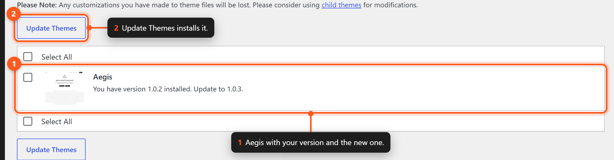

# Updating

This page explains how to update the Aegis theme to the latest version safely and efficiently.

## Before Updating

Before performing any update, take the following precautions:

1. **Back up your site** — Create a full backup of your database and files.
2. **Check the changelog** — Review the release notes shown with the update on **Dashboard → Updates**, or the theme's `CHANGELOG.md`, for breaking changes.
3. **Test in staging** — If possible, test the update on a staging environment first.
4. **Check plugin compatibility** — Ensure your companion plugins (Aegis Plugin, Aegis Pro) are compatible with the new theme version.

## Block Migration Notes

### `aegis/video` → `core/video`

The **`aegis/video`** custom block was removed. Existing content still using that block should be migrated to **`core/video`** before or after updating.

Run the migration script from the theme directory:

```bash
npm run migrate:video
# WordPress Studio:
npm run migrate:video:studio
```

The script converts `aegis/video` block markup to `core/video` in post content. Review affected pages in the Site Editor after running it.

### Related Posts

The **`core/query` Related Posts** block variation was removed. Replace those blocks with the **`aegis/related-posts`** theme block, or use **`aegisProRelatedPosts`** on Query Loop with [Aegis Pro (coming soon)](../../../../plugins/aegis-pro/docs/features/query-loop-pro.md) for advanced related-post queries.

Without the companion plugin, the theme block and its `blog-related-posts-*` patterns are always registered. With the companion plugin active, there is no parent Related Posts toggle: enable at least one extra at **Aegis → Blocks → Related Posts** to register the block and its patterns. See [Related Posts Block](../blocks/related-posts.md).

### Image Icon → `core/icon`

The **Image Icon** variation (`core/image` with `is-style-icon`) was removed. Insert the WordPress **Icon** block instead. IDs look like `core/home` or `social/facebook`.

Migrate leftover Image icons and legacy `aegis/{set}/{name}` Icon IDs:

```bash
wp aegis migrate-icons
# WordPress Studio:
studio wp aegis migrate-icons
# Preview only:
studio wp aegis migrate-icons --dry-run
```

The command updates all public post types and `widget_block` widgets. Review headers and patterns in the Site Editor afterward. See [SVG Icons](../features/svg-icons.md).

## Update Methods

### Method 1: Automatic Updates From GitHub (Recommended)

Since 1.0.1, Aegis updates itself from GitHub through the normal WordPress update screens. No plugin or account is needed.



*Aegis updates appear in Dashboard → Updates like any other theme.*

- `style.css` declares `Update URI: https://github.com/aegiswp/theme`, so WordPress does not look for Aegis on WordPress.org.
- The theme's updater (`src/Admin/GitHubUpdater.php`) reads the latest published release of `aegiswp/theme`. Drafts and pre-releases are skipped.
- When that release is newer than the installed version, WordPress shows the usual **Update now** link under **Appearance → Themes** and in **Dashboard → Updates**. The release notes open from the update link.
- The update installs the release asset `aegis.zip`, which contains a single `aegis/` folder, so the theme folder keeps its name.
- The auto-update toggle on the theme details screen works as for any other theme.
- Release data is cached for 6 hours (30 minutes after an error) and cleared after any update.

To update:

1. Go to **Dashboard → Updates** (or **Appearance → Themes**).
2. Click **Update now** for Aegis.

Developers can point the updater at a fork or mirror with the `aegis_theme_update_repository` filter. See [Hooks and Filters](../reference/hooks-and-filters.md#theme-filters).

```php
add_filter( 'aegis_theme_update_repository', fn() => 'my-org/aegis-fork' );
```

The repository must publish releases with an `aegis.zip` asset.

### Method 2: Manual Update via Upload

1. Download `aegis.zip` from the latest Aegis release.
2. Navigate to **Appearance → Themes**.
3. Click **Add New Theme** and then **Upload Theme**.
4. Select the downloaded `.zip` file.
5. Click **Install Now**.
6. When prompted, choose **Replace current with uploaded** to overwrite the existing installation.
7. Click **Activate** if the theme was deactivated during the process.

### Method 3: Manual Update via FTP

1. Download and extract `aegis.zip` from the latest release.
2. Connect to your server via FTP.
3. Navigate to `wp-content/themes/`.
4. Rename the existing `aegis` folder to `aegis-backup` (as a safety measure).
5. Upload the new `aegis` folder.
6. Verify the site works correctly.
7. Delete the `aegis-backup` folder once confirmed.

### Method 4: Using Git (Development)

If you installed Aegis via Git:

```bash
cd wp-content/themes/aegis
git fetch origin
git checkout main
git pull origin main
composer install --no-dev
npm install
npm run build
```

### Method 5: Using Composer

If you manage Aegis through Composer:

```bash
composer update aegiswp/theme
```

## Updating Companion Plugins

When updating the theme, you should also check for updates to companion plugins:

| Plugin | Update Location |
|--------|----------------|
| Aegis Plugin (free) | **Plugins → Installed Plugins**. Install it from the theme's admin notice, which downloads the latest plugin release |
| Aegis Pro | Coming soon |

Always update the theme and plugins together to ensure compatibility.

## Version Compatibility

Aegis follows semantic versioning (SemVer):

| Version Change | Meaning | Action Required |
|----------------|---------|-----------------|
| Patch (1.0.x) | Bug fixes, no breaking changes | Safe to update immediately |
| Minor (1.x.0) | New features, backwards compatible | Review new features, safe to update |
| Major (x.0.0) | Breaking changes possible | Read migration guide before updating |

## What Gets Preserved During Updates

The following customizations are preserved when you update:

- **Global Styles** — Colors, typography, and layout changes made in the Site Editor.
- **Template modifications** — Custom templates created in the Site Editor.
- **User-created patterns** — Patterns you have created yourself.
- **Database content** — Posts, pages, and media are never affected.
- **Plugin settings** — Companion plugin configurations remain intact.

## What May Be Overwritten

The following are overwritten during an update:

- **Theme files** — All PHP, JSON, and asset files in the theme directory.
- **Default templates** — Original templates are replaced with updated versions.
- **Default patterns** — Bundled patterns are replaced with updated versions.

> **Note:** If you have modified theme files directly (not recommended), those changes will be lost during an update. Always use child themes or the Site Editor for customizations.

## Troubleshooting Updates

### Update Failed

If an update fails:

1. Check file permissions on the `wp-content/themes/` directory.
2. Ensure sufficient disk space is available.
3. Check the PHP error log for specific error messages.
4. Try the manual upload or FTP method as a fallback.
5. If **Update now** never appears, the site may not reach `api.github.com`. Check outgoing HTTP requests in **Tools → Site Health**.

### Site Broken After Update

If your site does not work correctly after updating:

1. Clear all caches (browser, plugin, server).
2. Deactivate and reactivate the theme.
3. Check **Tools → Site Health** for any reported issues.
4. If the issue persists, restore your backup and report the issue through the [Aegis documentation site](https://www.atmostfear-entertainment.com/docs/aegis/).

### Rolling Back

To revert to a previous version:

1. Download the `aegis.zip` of the previous release.
2. Follow the manual update process (Method 2 or Method 3) using the older version file.

## Staying Informed

To be notified of new releases:

- New versions appear in **Dashboard → Updates** and on **Appearance → Themes**. Enable auto-updates for Aegis to install them automatically.
- Release news is published on the [Aegis documentation site](https://www.atmostfear-entertainment.com/docs/aegis/).

## Next Steps

- [[requirements]] — Verify your environment meets the latest requirements.
- [[common-issues]] — Solutions to common problems after updating.
