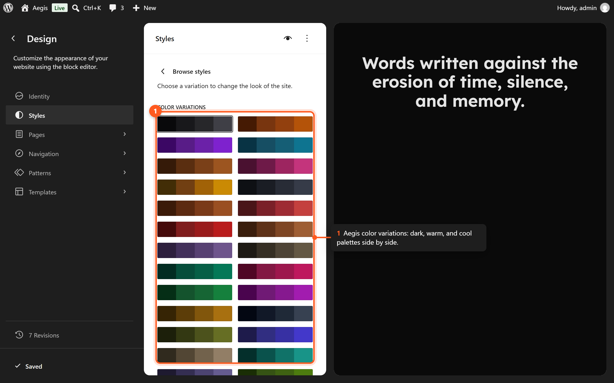

# Aegis theme inventory

Writing source for an introduction post. This file lists what the Aegis theme itself ships. It is not the post, and it does not replace the developer docs.

Scope is the theme directory, including the framework bundled in `vendor/aegis/`. Companion-plugin and Pro features are named only where a boundary matters, so they are not written up as theme features.

Left out on purpose: Map, Modal, analytics, conditional logic, the plugin Integrations screen, plugin-registered WooCommerce block patterns, and Pro blocks.

## Positioning

| | |
| --- | --- |
| Theme | Aegis |
| Author | Atmostfear Entertainment |
| Version | 1.0.2 |
| Requires WordPress | 7.0 |
| Tested up to | 7.1.3 |
| Requires PHP | 8.1 |
| License | GPL-2.0-or-later |
| Text domain | `aegis` |

The stylesheet header describes Aegis as a native block framework: full-site editing, fluid typography, and a strict standards-based base for child themes. That same header says the theme loads zero CSS, JavaScript, or font assets by default.

What the theme actually ships is a bit more specific. Three variable fonts are bundled and declared in `theme.json` (Lexend, Lexend Deca, and JetBrains), so they are not loaded from Google Fonts. The framework loads its CSS and JavaScript only when a block on the page needs them. `style.css` still contains a few rules of its own: linked-heading hover color, hidden gravatar captions, wide and full alignment inside post content, and payment-icon layout.

`readme.txt` is the public summary: a token-based block theme with color, type, and spacing scales, compiled custom blocks, a large pattern library, WooCommerce templates, dark and light mode, RTL, and an accessibility-ready foundation. This inventory counts the files: 50 templates and 234 patterns.

Directory tags in `style.css`: accessibility-ready, block-patterns, block-styles, blog, custom-colors, custom-logo, custom-menu, e-commerce, editor-style, featured-images, footer-widgets, full-site-editing, full-width-template, grid-layout, one-column, portfolio, rtl-language-support, sticky-post, style-variations, template-editing, threaded-comments, three-columns, translation-ready, two-columns, wide-blocks.

## Design system

Tokens live in `theme.json` (schema version 3, title "Light"). Values below are the theme defaults, not every hex.

### Editor settings

- Appearance tools are on.
- Root-padding-aware alignments are on.
- Border color, radius, style, and width are on.
- Lightbox is enabled.
- Sticky position is on.
- Minimum width is on.
- Custom duotones and custom gradients are on. The default WordPress palette, default duotones, and default gradients are off.
- Link color is on.
- Spacing units: `%`, `em`, `px`, `rem`, `vh`, `vw`. Custom spacing sizes are on.

### Layout

| Preset | Value |
| --- | --- |
| Content width | `min(calc(100% - var(--wp--preset--spacing--lg,3rem) * 2), 720px)` |
| Wide width | `min(calc(100% - var(--wp--preset--spacing--lg,3rem) * 2), 1200px)` |

The wide size in `theme.json` is 1200px. Older copy that says 1620px or 1152px is out of date.

On phones, full-width blocks inside `main.site-main.has-global-padding` cancel the root padding with negative margins (`style.css`), so nested full-width groups no longer stack extra padding.

### Color

40 palette entries (includes `transparent`).

| Family | Steps |
| --- | --- |
| Primary | 12, including 25 through 950 |
| Neutral | 12, including 0 through 950 |
| Success | 3: 100, 500, 600 |
| Info | 3: 100, 500, 600 |
| Warning | 3: 100, 500, 600 |
| Error | 3: 100, 500, 600 |
| Utility | Transparent, Current, Inherit, Shadow |

Default page background is Neutral 0 (`#ffffff`). Default text is Neutral 700. Body type is Lexend at 16px, normal weight, line-height 1.6. Block gap is the S spacing preset. Root horizontal padding is the L spacing preset.

**10 duotones:** Primary Dark/Light, Primary Dark/Mid, Neutral Dark/Light, Neutral Dark/Warm, Success Dark/Light, Success Dark/Bright, Warning Dark/Light, Warning Dark/Bright, Error Dark/Light, Error Dark/Bright.

**31 gradients:** Primary 700/500, Primary 500/300, Primary Transparent, Primary Foreground, Body/Heading, Surface/Border, Background/Transparent, Transparent/Background, Fade Left, Fade Right, Checkerboard, Grid, Diagonal Cut Dark Left, Diagonal Cut Dark Right, Diagonal Cut Light Left, Diagonal Cut Light Right, Fade Dark Top, Fade Dark Bottom, Long Top Short Bottom, Short Top Long Bottom, Vignette Vertical, Vignette Radial, Diagonal Vignette, Scrim Bottom, Scrim Top, Diagonal Triple, Layered Bands, Spotlight Bottom Left, Spotlight Top Right, Cinematic Bars, Diagonal Stripes.

### Typography

27 fluid font-size presets, plus Inherit: 96, 88, 80, 72, 64, 60, 56, 52, 48, 44, 42, 40, 36, 32, 28, 24, 22, 20, 18, 16, 15, 14, 13, 12, 11, 10, 8. The slug is the number (`--wp--preset--font-size--44`). Each one is a `clamp()` between a mobile minimum and the named size, so large sizes shrink on phones (for example, 96 starts at 56px).

| Family | Slug | Face |
| --- | --- | --- |
| Lexend | `lexend` | Variable, weight 300–900, `assets/fonts/lexend.woff2` |
| Lexend Deca | `lexend-deca` | Variable, weight 300–900, `assets/fonts/lexend-deca.woff2`, falls back to Lexend |
| JetBrains (JetBrains Mono) | `jetbrains` | Variable, weight 100–900, in `assets/fonts/` |

Custom font-weight tokens run from thin (100) through black (900).

Element defaults cover button (Primary 900 background, Neutral 0 text, semibold 14px, 6px radius, hover to Primary 800), text inputs, caption, heading, h1–h6, and link.

Block style defaults in `theme.json` cover audio, avatar, buttons, breadcrumbs, button, code, column, columns, comment author avatar, post excerpt, cover, footnotes, html, image, list, navigation, page list, post author, post content, post date, post featured image, post template, post terms, preformatted, pullquote, quote, search, separator, site logo, site title, social links, template part, text columns, verse, and video.

### Spacing

11 steps. XXXS 4px, XXS 8px, 2XS 12px, and XS 16px are fixed. The rest are fluid `clamp()` values: S 20–24px, M 24–32px, ML 24–40px, L 24–48px, XL 40–64px, XLL 48–80px, XXL 56–96px.

### Shadows

Eight presets: None, XX Small, X Small, Small, Medium, Large, X Large, XX Large. They use a shared shadow color token.

### Other custom tokens

- Border: 1px solid Neutral 200, 6px radius.
- Transition: 0.1s ease-in.
- Surface: 8px backdrop blur, shared radius, overlay at 50% Neutral 50.
- Checklist marker color: Success 600.

## Style variations

60 variations in `styles/`. Each file sets `title` to the name below. Mood notes are the theme's own labels from the style-variation reference. Every variation keeps its own dark mapping when dark mode is on.

*A selection of the 60 Aegis style variations.*

| Variation | Character |
| --- | --- |
| Amber | Energetic, warm |
| Amethyst | Luxurious, mystical |
| Arctic | Clean, cool |
| Autumn | Warm, seasonal |
| Blossom | Gentle, feminine |
| Canary | Cheerful, attention-grabbing |
| Charcoal | Serious, professional |
| Copper | Industrial, warm |
| Coral | Vibrant, playful |
| Crimson | Bold, powerful |
| Desert | Earthy, natural |
| Dusk | Evening, atmospheric |
| Earth | Grounded, organic |
| Emerald | Rich, prestigious |
| Flamingo | Fun, creative |
| Forest | Natural, serene |
| Fuchsia | Vivid, expressive |
| Gilded | Premium, luxurious |
| Grayscale | Minimal, typographic |
| Grove | Natural, growth |
| Indigo | Deep, trustworthy |
| Ivory | Elegant, clean |
| Lagoon | Refreshing, tropical |
| Lavender | Calming, gentle |
| Lime | Energetic, fresh |
| Linen | Soft, comfortable |
| Marigold | Bright, optimistic |
| Midnight | Dramatic, sleek |
| Mist | Subtle, airy |
| Moss | Understated, natural |
| Neon | Bold, modern |
| Neutral | Versatile, quiet |
| Obsidian | Dramatic, high-contrast |
| Ocean | Professional, trustworthy |
| Orchid | Exotic, creative |
| Parchment | Vintage, literary |
| Peach | Warm, approachable |
| Pewter | Cool, professional |
| Plum | Rich, sophisticated |
| Raspberry | Bold, spirited |
| Rose | Romantic, soft |
| Rustic | Authentic, handcrafted |
| Sage | Calm, wise |
| Sand | Neutral, coastal |
| Sapphire | Premium, deep |
| Sepia | Vintage, nostalgic |
| Sky | Open, friendly |
| Slate | Professional, modern |
| Steel | Strong, utilitarian |
| Stone | Solid, dependable |
| Sunflower | Happy, vibrant |
| Tangerine | Energetic, warm |
| Tea | Refined, peaceful |
| Teal | Balanced, modern |
| Terracotta | Warm, artisanal |
| Vintage | Retro, eclectic |
| Violet | Creative, regal |
| Walnut | Warm, refined |
| Wine | Elegant, mature |
| Zinc | Default, neutral |

Midnight, Obsidian, and Zinc use a dark default background (`primary-950`).

## Templates

50 HTML templates in `templates/`. Titles below are the Site Editor names from `theme.json` where the theme defines one. Hierarchy templates that WordPress provides by filename are named from that role.

Template parts, in `parts/`: Header (`header`), Footer (`footer`), Sidebar (`sidebar`).

### Site

| Template | File | Role |
| --- | --- | --- |
| Index | `index.html` | Fallback loop |
| Front Page | `front-page.html` | Static front page |
| Blog Home | `home.html` | Posts page |
| Page | `page.html` | Default page. Also used for bbPress forum views when that integration is active |
| Single | `single.html` | Default post |
| Archive | `archive.html` | Generic archives |
| Author | `author.html` | Author archives |
| Author: Guest | `author-guest.html` | Guest author archives |
| Date | `date.html` | Date archives |
| Search | `search.html` | Search results |
| 404 | `404.html` | Not found |

### Page and post layouts

| Template | File | Assignable to |
| --- | --- | --- |
| Blank | `blank.html` | Page, post. No header or footer |
| Full Width | `full-width.html` | Page, post |
| Page (No Title) | `page-no-title.html` | Page, post |
| Page: Boxed | `page-boxed.html` | Page, post |
| Page: Hero Minimal | `page-hero-minimal.html` | Page |
| Page: Contact | `page-contact.html` | Page |
| Page: Landing | `page-landing.html` | Page |
| Page: With Sidebar | `page-with-sidebar.html` | Page, post |
| Single: Full Width | `single-full-width.html` | Post |
| Single: No Featured Image | `single-no-featured-image.html` | Post |
| Coming Soon | `coming-soon.html` | Page |
| Page: Coming Soon | `page-coming-soon.html` | Page |
| Maintenance | `maintenance.html` | Page |

### Content archives

| Template | File |
| --- | --- |
| Category Archives | `taxonomy-category.html` |
| Category: Books | `taxonomy-category-books.html` |
| Category: Events | `taxonomy-category-events.html` |
| Category: Podcasts | `taxonomy-category-podcasts.html` |
| Category: Portfolio | `taxonomy-category-portfolio.html` |
| Category: Recipes | `taxonomy-category-recipes.html` |
| Category: Video | `taxonomy-category-video.html` |
| Tag Archives | `taxonomy-post_tag.html` |
| Tag: Featured | `taxonomy-post_tag-featured.html` |

### Shop

These files are in the theme. They apply when WooCommerce is active, and the framework hides them from the template picker when WooCommerce is inactive. Wishlist also expects the TI WooCommerce Wishlist plugin and the companion plugin's wishlist pattern. The multi-step checkout template is the theme's; extra checkout assets from the companion plugin load only when that integration is on.

| Template | File |
| --- | --- |
| Archive: Product | `archive-product.html` |
| Single item: Product | `single-product.html` |
| Single Product: Landing | `single-product-landing.html` |
| Product Search Results | `product-search-results.html` |
| Search: Product | `search-product.html` |
| Taxonomy Product Category | `taxonomy-product_cat.html` |
| Taxonomy Product Tag | `taxonomy-product_tag.html` |
| Product Attribute | `taxonomy-product_attribute.html` |
| Product Category: Clothing | `taxonomy-product_cat-clothing.html` |
| Product Category: Digital | `taxonomy-product_cat-digital.html` |
| Product Category: Outlet | `taxonomy-product_cat-outlet.html` |
| Page: Cart | `page-cart.html` |
| Page: Checkout | `page-checkout.html` |
| Page: Checkout Multi-Step | `page-checkout-multi-step.html` |
| Order Confirmation | `order-confirmation.html` |
| Page: My Account | `page-my-account.html` |
| Page: Wishlist | `page-wishlist.html` |

Shop styling that also ships in the theme framework, and applies with WooCommerce: breadcrumb styling (including the Store Breadcrumb delimiter), the sale badge, and the product-gallery lightbox. WooCommerce block patterns that use `wp:woocommerce/*` are registered by the companion plugin, not by these theme files.

## Patterns

`patterns/` contains **234 registered patterns** in 28 folders. The registrar loads `*.php` in each folder and skips files whose names start with a dot. 52 files set `Inserter: false`: all 48 in `template`, the 3 in `hidden`, and `utility/patterns.php`. Patterns in the `hidden` category are also kept out of the inserter by the pattern loader. Modal starters are owned by the companion plugin, not this tree.

Inserter category labels match the folder name, with `cta` and `faq` shown as CTA and FAQ. Registered slugs are the category plus the file's `Slug` header, for example `hero-split`. The full slug list is in the [Pattern Reference](reference/pattern-reference.md).

### about (3)

| Pattern | Description |
| --- | --- |
| About Founder Story | A founder story section with image and narrative text. |
| About Mission Vision | A two-column mission and vision section with large text. |
| About Values Grid | A grid of company core values with icons and descriptions. |

### author (6)

| Pattern | Description |
| --- | --- |
| Author Archive with Sidebar | An author archive with a sticky sidebar containing author details and a post list. |
| Author Archive | A full-width author archive with avatar header and three-column post grid. |
| Author Biography Card | A compact author card with avatar, name, role, short bio, and social links. |
| Author Biography Horizontal | A slim horizontal author strip with avatar, name, bio, and social links in a single row. |
| Author Biography | A centered author biography section with large avatar, bio text, and social links. |
| List with Author | A horizontal list layout with author information. |

### blog (16)

| Pattern | Description |
| --- | --- |
| Blog Feed | Blog section with featured article, latest articles list, and newsletter signup. |
| Featured Post | A highlighted featured post layout. |
| Featured Posts | A grid of featured blog posts. |
| Grid Boxed | A boxed grid layout for blog posts. |
| Grid Compact | A compact grid with small thumbnails and titles. |
| Grid Masonry | A masonry-style grid with alternating post sizes. |
| Latest Posts | A section displaying the latest blog posts. |
| Minimal | A clean, text-focused minimal blog layout. |
| Related Posts: Cards | Boxed cards of related posts with surface background and shadow. |
| Related Posts: Grid | A 3-column grid of related posts with featured image, date, category, title, and excerpt. |
| Related Posts: List | A horizontal list of related posts with small thumbnails, titles, and dates. |
| Related Posts: Minimal | A text-only list of related posts with border separators. |
| Single Blog Card | A single blog post card layout. |
| Single Column | A single column blog post list. |
| Three Column Blog | A three-column blog post grid with pagination. |
| Two Column Featured | Two column layout with featured post and sidebar list. |

### commerce (8)

| Pattern | Description |
| --- | --- |
| Money-Back Guarantee | A money-back guarantee section with SVG icon, heading, and description. |
| Payment Icons | Accepted payment method icons that inherit the theme dark/light color scheme. Use Payment Icons (Brand Colors) for original card colors. |
| Product Comparison | A side-by-side product comparison table pattern for comparing product features. |
| Product Reviews | A standalone product reviews section with star rating summary and individual review cards. |
| Recently Viewed Products | A section displaying recently viewed products using a product collection grid. |
| Shipping Information | A shipping policy and information section with SVG icons for delivery times, return policy, and international shipping. |
| Size Guide | An expandable size guide table pattern for apparel and clothing stores. |
| Trust Badges | A row of inline SVG trust icons for secure checkout, money-back guarantee, free shipping, and 24/7 support. |

### contact (5)

| Pattern | Description |
| --- | --- |
| Form Boxed | A boxed contact form layout. |
| Contact Form Map Overlay | A contact form with map overlay background. |
| Contact Form Map | A contact form with embedded map. |
| Contact Icons | Contact information with icons. |
| Contact Two Column | A two-column contact section with form and info. |

### cta (7)

| Pattern | Description |
| --- | --- |
| Feature Banner | A scrolling banner for announcements or promotions. |
| Box | A boxed call-to-action section. |
| Commerce Free Shipping CTA | A slim announcement bar CTA promoting free shipping with a threshold and shop link. |
| Commerce Newsletter CTA | A newsletter signup CTA with discount incentive for store visitors. |
| Commerce Sale CTA | A bold sale banner CTA with countdown urgency, discount code, and shop button. |
| Horizontal | A horizontal call-to-action section. |
| Newsletter CTA | A newsletter subscription call-to-action section. |

### event (28)

| Pattern | Description |
| --- | --- |
| Cinema About | An about section for a film with description and stat cards for ratings, awards, and format. |
| Cinema Cast & Crew | A dark section showcasing cast and crew members with circular avatars. |
| Cinema CTA | A dark call-to-action section for a cinema premiere with ticket button. |
| Cinema Hero | A dark cover hero section for a cinema screening or film premiere with poster, details, and CTA buttons. |
| Conference CTA | A dark call-to-action section for conference registration with early bird pricing. |
| Conference Hero | A dark hero section for a tech conference with stats and CTA buttons. |
| Conference Speakers | A keynote speakers section with avatar cards showing name, role, and bio. |
| Conference Tracks | A conference tracks section with bordered cards showing track names and descriptions. |
| Conference Venue | A venue and travel section with image and location details including hotel partners. |
| Exhibition About | An about section for an exhibition with curator statement and exhibition details. |
| Exhibition Artists | A featured artists section with cards showing artist name, medium, and description. |
| Exhibition Gallery | A gallery grid section showcasing exhibition artwork with captions. |
| Exhibition Hero | A cover hero section for an art exhibition with dates, description, and CTA buttons. |
| Exhibition Info | An information section with museum hours, location, and contact details. |
| Exhibition Tours | A guided tours section with tour options showing times, descriptions, and booking buttons. |
| Music Festival Hero | A vibrant cover hero section for a music festival with date, description, and CTA buttons. |
| Music Festival Info | An essential information section for a music festival with practical details. |
| Music Festival Lineup | A lineup section for a music festival organized by day with headliners and supporting acts. |
| Music Festival Passes | A festival passes pricing section with tiered options and features. |
| Talk Hero | A dark hero section for a talk or lecture with speaker details and CTA buttons. |
| Talk Series | An upcoming lecture series section with event cards showing dates and topics. |
| Talk Speaker | An about the speaker section with image, bio, and credentials. |
| Talk Topics | A what you will learn section with topic cards for a talk or lecture. |
| Workshop CTA | A dark call-to-action section for workshop enrollment with included items list. |
| Workshop Gallery | A gallery section showcasing student work and workshop moments. |
| Workshop Hero | A cover hero section for a workshop with instructor, date, and CTA buttons. |
| Workshop Instructor | An instructor profile section with image, bio, and credentials. |
| Workshop Schedule | A two-day workshop schedule with session times and descriptions. |

### faq (3)

| Pattern | Description |
| --- | --- |
| Accordion With Sidebar | A wide accordion FAQ section. |
| Accordion | An accordion FAQ section. |
| FAQs | A frequently asked questions section. |

### featured (5)

| Pattern | Description |
| --- | --- |
| Feature Alternating | Alternating feature sections with images and text. |
| Feature Grid Icons | A grid of features with icons and descriptions. |
| Feature Icon Boxes | A grid of icon boxes showcasing features or services. |
| Image | A feature section with image and content. |
| Feature Images Two Column | A two-column feature section with staggered images. |

### footer (6)

| Pattern | Description |
| --- | --- |
| Centered | A centered footer with logo and copyright. |
| Footer Default | — |
| Minimal | A minimal footer layout. |
| Store Footer Default | A full store footer with shop links, customer service links, payment icons, and newsletter signup. |
| Store Footer Minimal | A minimal store footer with copyright, privacy/terms links, and payment icons — ideal for checkout and funnel pages. |
| Wide | A wide footer with multiple columns. |

### header (6)

| Pattern | Description |
| --- | --- |
| Center Logo | A header with centered logo and navigation. |
| Header Center Menu | A header with centered menu navigation. |
| Header Default | — |
| Menu Left | A header with left-aligned menu. |
| Store Header Default | A full store header with logo, shop navigation, search, customer account, and mini-cart. |
| Store Header Minimal | A minimal store header with logo and secure checkout badge — ideal for checkout and funnel pages. |

### hero (7)

| Pattern | Description |
| --- | --- |
| Hero Archive | A hero section for archive pages. |
| Hero Centered Dark | A dark centered hero with gradient background. |
| Hero Cover | A full-screen hero cover section. |
| Hero Image Below | A hero section with image below content. |
| Hero Minimal | A minimal hero with subheading, title, and short intro text. |
| Hero Split | A split hero section with text and image side by side. |
| Hero Video | A hero section with video background placeholder. |

### hidden (3)

| Pattern | Description |
| --- | --- |
| Page 404 | A 404 error page layout. Not shown in the inserter. |
| 404 Illustrated | A 404 error page with a large illustration area and search prompt. Not shown in the inserter. |
| 404 Minimal | A minimal 404 error page with heading and navigation link. Not shown in the inserter. |

### logos (3)

| Pattern | Description |
| --- | --- |
| As Seen In | An "as seen in" press bar with publication logos. |
| Logo Grid | A grid of client or partner logos with a heading. |
| Logo Row | A single row of logos with a centered label above. |

### newsletter (3)

| Pattern | Description |
| --- | --- |
| Newsletter Banner | A full-width dark newsletter banner with centered content. |
| Newsletter Inline | A compact inline newsletter signup with input and button side by side. |
| Newsletter Split | A split layout with content on one side and newsletter signup on the other. |

### notice (16)

| Pattern | Description |
| --- | --- |
| Affiliate Disclaimer | A standard FTC-style affiliate earnings disclosure notice with an info icon. |
| Beta Disclaimer | A compact beta or experimental feature disclaimer tag. |
| Earnings Disclaimer | An earnings and income disclaimer for digital products, courses, and business opportunities. |
| Editorial Independence Disclaimer | A centered editorial independence and journalistic integrity statement. |
| Financial Disclaimer | An investment and financial information disclaimer with a currency icon. |
| Legal Disclaimer | A formal general-purpose legal and liability disclaimer with a separator line. |
| Medical Disclaimer | A prominent medical disclaimer warning that content is not professional health advice. |
| Sponsored Content Disclaimer | A compact inline disclosure for sponsored or paid partnership content. |
| Testimonial Disclaimer | A full-width results-not-typical disclosure for testimonials and case studies. |
| Age Verification Notice | An age verification gate notice with a lock icon and confirmation button. |
| Error Notice | A critical error notice box with a red background and error icon. |
| Geographic Restriction Notice | A geographic restriction notice for region-blocked content. |
| Info Notice | A general informational notice box with an info icon. |
| Success Notice | A success notice box with a green background and check icon. |
| Under Construction | A centered under-construction or maintenance placeholder notice. |
| Warning Notice | A warning notice box with an amber background and warning icon. |

### pages (20)

| Pattern | Description |
| --- | --- |
| About Page | A complete about page layout with hero, story, team, and values. |
| Blog Page | A complete blog page with featured post and grid layout. |
| Cinema Event | A full page layout for a cinema screening or film premiere event. |
| Conference Event | A professional full page layout for a tech conference or summit. |
| Contact Page | A complete contact page with form, map, and contact details. |
| Exhibition Event | A minimal and elegant full page layout for an art exhibition or gallery event. |
| Funnel Sales Page | A long-form sales page with problem/solution framing, feature highlights, testimonials, FAQ, guarantee, and CTA — uses minimal header/footer. |
| Funnel Squeeze Page | A high-conversion squeeze page with headline, benefit bullets, and email capture form — uses minimal header/footer. |
| Funnel Thank You Page | A post-purchase thank you page with order confirmation message, next steps, upsell product grid, and social sharing — uses minimal header/footer. |
| Page Home | — |
| Landing Page | A full landing page with hero, features, social proof, testimonials, contact form, and closing CTA. |
| Music Festival | A vibrant full page layout for a music festival or concert event. |
| Portfolio Page | A complete portfolio page showcasing projects and work. |
| Product Landing Page (Dynamic) | A dynamic product landing page using WooCommerce product collections, featured products, on-sale grid, and category browsing. |
| Product Landing Page (Static) | A static product landing page with hero, features, testimonials, trust badges, and CTA — ideal for a single flagship product. |
| Services Page | A complete services page layout showcasing offerings. |
| Shop Full Width | A full-width shop page with top-bar filters and a wide product grid without sidebar. |
| Shop Page | A complete shop landing page for e-commerce sites. |
| Talk & Lecture Event | A focused full page layout for a single talk, lecture, or keynote presentation. |
| Workshop Event | A full page layout for a hands-on workshop or training event. |

### portfolio (3)

| Pattern | Description |
| --- | --- |
| Portfolio Image Gallery Grid | A grid-based image gallery for portfolios. |
| Portfolio Image Gallery | An image gallery for portfolio showcases. |
| Project Showcase | A detailed project showcase layout. |

### pricing (4)

| Pattern | Description |
| --- | --- |
| Pricing Comparison Table | A feature comparison table across multiple pricing plans. |
| Pricing Single Highlight | A single highlighted pricing card with feature list and CTA. |
| Pricing Three Column | A three-column pricing table. |
| Pricing Two Column | A two-column pricing comparison layout. |

### product (3)

| Pattern | Description |
| --- | --- |
| Product Category Grid | Product category cards with images, titles, and product counts. |
| Featured Product Grid | A three-column featured products grid with sale badges, ratings, and Add to Cart buttons. |
| On Sale Products | On-sale products grid filtered to show only discounted items. |

### sidebar (1)

| Pattern | Description |
| --- | --- |
| Sidebar Default | A complete blog sidebar with author bio, search, recent posts, categories, archives, calendar, tags, and social links. |

### slider (7)

| Pattern | Description |
| --- | --- |
| Books Slider | A full-width book slider with cover image on the left and title, description, and CTAs on the right. |
| Features Slider | A features carousel displaying service cards with icons and descriptions. |
| Hero Slider | A full-width hero slider with call-to-action buttons. |
| Latest Posts Carousel | A card carousel of the latest posts with featured image, category, date, title, and excerpt. |
| Portfolio Carousel | A multi-slide portfolio carousel showcasing projects with hover overlays. |
| Team Carousel | A team members carousel with profile photos and social links. |
| Testimonials Slider | A testimonials carousel with customer reviews, avatars, and star ratings. |

### stats (4)

| Pattern | Description |
| --- | --- |
| Stats Four Columns | A four-column statistics section. |
| Stats Progress Bars | A stats section with labeled progress bars showing skill or completion percentages. |
| Stats Three Columns Dark | A dark three-column statistics section. |
| Stats Two Column Icons | A two-column stats section with icons and descriptions. |

### team (4)

| Pattern | Description |
| --- | --- |
| Team Cards Social | Team member cards with photos, roles, bios, and social links. |
| Team Grid Simple | A simple grid layout for team members. |
| Team Members | A team members section. |
| Team Spotlight | A single team member spotlight with large photo and detailed bio. |

### template (48)

| Pattern | Description |
| --- | --- |
| Template 404 | Not shown in the inserter. |
| Archive Product | Not shown in the inserter. |
| Template Archive | Not shown in the inserter. |
| Author Guest | Not shown in the inserter. |
| Template Author | Not shown in the inserter. |
| Blank | Minimal page shell with skip link and main landmark. Authors should supply exactly one h1 in post content. Not shown in the inserter. |
| Coming Soon | Not shown in the inserter. |
| Template Date | Not shown in the inserter. |
| Front Page | Not shown in the inserter. |
| Full Width | Not shown in the inserter. |
| Blog Home | Not shown in the inserter. |
| Maintenance | Not shown in the inserter. |
| Order Confirmation | Not shown in the inserter. |
| Page Boxed | Not shown in the inserter. |
| Page Cart | Not shown in the inserter. |
| Page Checkout Multi-Step | Not shown in the inserter. |
| Page Checkout | Not shown in the inserter. |
| Page Coming Soon | Not shown in the inserter. |
| Page Contact | Not shown in the inserter. |
| Page Hero Minimal | Not shown in the inserter. |
| Page Landing | Not shown in the inserter. |
| Page My Account | Not shown in the inserter. |
| Page No Title | Page template without an automatic title. Authors must supply exactly one h1 heading in the page content. Not shown in the inserter. |
| Page Wishlist | Not shown in the inserter. |
| Page With Sidebar | Not shown in the inserter. |
| Template Page | Not shown in the inserter. |
| Search Product | Not shown in the inserter. |
| Template Search | Not shown in the inserter. |
| Single Full Width | Not shown in the inserter. |
| Single No Featured Image | Not shown in the inserter. |
| Single Product Landing | Not shown in the inserter. |
| Single Product | Not shown in the inserter. |
| Template Single | Not shown in the inserter. |
| Category Books | Not shown in the inserter. |
| Category Events | Not shown in the inserter. |
| Category Podcasts | Not shown in the inserter. |
| Category Portfolio | Not shown in the inserter. |
| Category Recipes | Not shown in the inserter. |
| Category Video | Not shown in the inserter. |
| Category Archive | Not shown in the inserter. |
| Tag Featured | Not shown in the inserter. |
| Tag Archive | Not shown in the inserter. |
| Product Attribute | Not shown in the inserter. |
| Product Category Clothing | Not shown in the inserter. |
| Product Category Digital | Not shown in the inserter. |
| Product Category Outlet | Not shown in the inserter. |
| Taxonomy Product Category | Not shown in the inserter. |
| Taxonomy Product Tag | Not shown in the inserter. |

### testimonial (6)

| Pattern | Description |
| --- | --- |
| Brands | A brands and partners showcase. |
| Testimonial Cards Grid | A grid of testimonial cards with ratings. |
| Logo Cloud | A logo cloud showcasing clients or partners. |
| Testimonial Quote Large | A large centered testimonial quote. |
| Testimonial Single | A single testimonial quote. |
| Testimonial Three Column | A three-column testimonial section. |

### timeline (3)

| Pattern | Description |
| --- | --- |
| Timeline Horizontal | A horizontal timeline with numbered step cards. |
| Timeline Stacked | A minimal stacked timeline with left border accent and date labels. |
| Timeline Vertical | A classic vertical timeline with alternating left and right entries. |

### utility (6)

| Pattern | Description |
| --- | --- |
| Color Palette | — |
| Utility Dark Mode Toggle | — |
| Gradients | — |
| Patterns | Not shown in the inserter. |
| Skip to Content | Accessibility link that allows keyboard users to skip navigation and jump directly to main content. |
| Utility Search Toggle | — |

## Theme blocks

Registered by the theme from `src/Blocks/`. They work without the companion plugin.

| Block | Name | What it is |
| --- | --- | --- |
| Countdown | `aegis/countdown` | Timer to a date and time, with segments, labels, and expiry behavior |
| Slider | `aegis/slider` | Carousel with layout and navigation options |
| Slide | `aegis/slide` | One slide. Only inside Slider |
| Toggle | `aegis/toggle` | Two-view content switcher. For FAQs, use Accordion List instead |
| Toggle Content | `aegis/toggle-content` | Primary or secondary view inside Toggle |
| Related Posts | `aegis/related-posts` | Posts related by shared terms, with layout variants and a fallback |

Video is WordPress `core/video`, styled by the theme. There is no `aegis/video` block.

Related Posts query arguments can be changed with the `aegis_related_posts_query` filter.

## Block variations

Registered by the bundled framework on core blocks:

| Variation | Base block | What it is |
| --- | --- | --- |
| Accordion List | `core/list` | Expand and collapse list items. Style `is-style-accordion` |
| Counter | `core/paragraph` | Number that counts up when it scrolls into view |
| Curved Text | `core/paragraph` | Text along a curved path |
| Grid | `core/group` | CSS grid container |
| Marquee | `core/group` | Horizontal ticker |
| Newsletter | `core/search` | Search form styled as an email signup (`is-style-newsletter`) |
| SVG | `core/image` | Inline SVG on an Image block (`is-style-svg`), for logos and wordmarks |

Decorative icons use the Icon block, not the SVG image variation.

The companion plugin can turn variations off at Aegis → Blocks. That screen is not part of the theme.

## Block styles

Styles the framework registers for the editor:

| Block | Styles |
| --- | --- |
| Archive title | Sub-heading |
| Buttons | Surface |
| Button | Ghost |
| Code | Surface, Light, Dark |
| Columns | Surface, Light, Dark |
| Column | Surface, Light, Dark |
| Comment author name | Heading |
| Details | Heading (summary) |
| Group | Surface, Light, Dark |
| List | Checklist, Check outline, Check circle, Square, List heading, Dash, None |
| List item | Surface |
| Navigation | Heading |
| Page list | None |
| Paragraph | Sub-heading, Notice, Heading |
| Post author name | Heading |
| Post terms | List, Sub-heading, Badges |
| Post title | Sub-heading |
| Query pagination | Badges |
| Read more | Button |
| Site title | Heading |
| Spacer | Angle, Curve, Round, Wave, Fade |
| Tag cloud | Badges |
| Quote | Surface |

The framework also removes the core Rounded and Default styles from Image and Site Logo, and the Wide and Dots styles from Separator.

Navigation overlay styles, registered separately:

| Style | Behavior |
| --- | --- |
| Slide-in | Drawer from the right |
| Slide-in Left | Drawer from the left |
| Fullscreen | Full-viewport overlay |
| Scroll | Overlay that slides down from the top |

## Inspector controls

Extra block controls from the framework. Names only. Plugin toggles that disable them are out of scope.

| Control | What it adds |
| --- | --- |
| Additional styles | Custom CSS on a block. Saved by a user without the `unfiltered_html` capability, only the CSS properties WordPress allows in post content are kept |
| Animation | Motion, with CSS and script loaded when used |
| Backdrop blur | Backdrop-filter blur |
| Box shadow | Shadow beyond the eight presets |
| Text shadow | Shadow on text |
| CSS filters | Filter effects |
| Transform | CSS transforms |
| Opacity | Opacity control |
| Responsive | Breakpoint layout, including visibility and positioning |
| Visibility | Server-side show and hide from a visibility attribute |
| Subheading | Sub-heading treatment, including gradient clip |
| Template tags | Replacements in block content, including reading time at 200 words per minute (`aegis_words_per_minute`). `{field}` tags print public post fields only (`aegis_template_tag_post_fields`) and custom fields that do not start with `_`. Nothing is printed for password-protected posts or posts the visitor cannot read |
| Query layout | Responsive layout on Query |
| Query enhancements | Extra query parameters |
| Query no results | Custom empty state for Query |
| Image | Image inspector options such as aspect ratio, height, object-fit, and object-position |
| Inline color | Inline color |
| Inline SVG | Inline SVG rendering |
| Copy to clipboard | Copy control on code |
| Onclick | Click action and template-tag replacement. Kept only when the user who saves the content has the `unfiltered_html` capability |
| Placeholder | Placeholder content when a block is empty |

## Icons

The theme registers icon collections on the WordPress Icon block (`core/icon`). Fills use `currentColor`, so icons follow the surrounding text in light and dark mode.

| Collection | Icons | Where it lives |
| --- | --- | --- |
| Social | 44 | `vendor/aegis/icons` |
| WordPress | 214 | `vendor/aegis/icons` |
| Payment | 6 | `assets/icons/payment` |
| Payment (brand colors) | 6 | `assets/icons/payment-brand` |
| Integrations | 15 | `assets/icons/integrations` (single-color plugin marks) |

The payment set follows the theme color scheme. The brand-color set keeps the original card colors. Core already ships its own `core` collection; Aegis does not duplicate those glyphs.

The theme does not allow SVG uploads. SVG icons and images come from files that ship with the theme or plugins.

## Navigation and search

- Overlay menus: the four styles in the block-styles section.
- Submenus support multi-column mega menus on `core/navigation-submenu`.
- Headers can be sticky, transparent, or absolutely positioned.
- Search has a CSS-only toggle, including a full-screen treatment, in the Utility Search Toggle pattern.

## Dark mode

Dark mode is a class, not a separate theme.

- `is-style-dark` on the body, or on a section, remaps the color tokens.
- A visitor toggle stores the choice in `localStorage`.
- `prefers-color-scheme` can follow the system unless the visitor has chosen.
- All 60 style variations keep their own dark palette.
- Per-section dark mode is the same class on a Group.

Color-scheme conditionals in the plugin admin are not a theme feature.

## Accessibility and performance

- Skip link auto-injected before the header (`SkipLink`); also shipped as the Skip to Content pattern (used by the Blank template, which has no header).
- Visible `:focus` / `:focus-visible` styles in light and dark (global links, buttons, search, breadcrumbs, post meta).
- Semantic landmarks in templates: header, nav, main, article, section, aside (sidebar), footer; Blank and default templates wrap content in `<main id="main">`.
- Keyboard support on Slider, Toggle, Accordion List, and the search dialog (`role="dialog"`, Escape, focus trap/return).
- Stock patterns: labeled demo forms, unique field IDs, hero slider slide titles as `<h2>`, demo CTAs use real `home_url` destinations, slider autoplay off by default and disabled under `prefers-reduced-motion`.
- `neutral-400` token is `#666666` for muted text contrast on the default body background.
- RTL and a translation-ready `aegis` text domain (`languages/aegis.pot`).
- Framework CSS and JavaScript load when the page uses the feature, not as a single front-end bundle.
- CI: pa11y-ci WCAG2AA with threshold 0 (`.pa11yci.json` defaults; workflow writes `.pa11yci.ci.json` with resolved IDs for `php -S`). WPAudit skip-link check covers `SkipLink.php` / `skip-to-content.php`.
- The theme ships an accessibility-ready foundation aimed at WCAG 2.2 AA. Full conformance still depends on editor content, plugins, and runtime testing.

## Other theme behavior

- **Embeds.** `embed-content.php` replaces the default oEmbed layout: featured image, title, date, excerpt, term, then site icon and name. It outputs Article schema (headline, url, dates, author, publisher, image).
- **Dynamic template parts.** `aegis_dynamic_template_part_slug` can swap header, footer, or sidebar at render time when `parts/{slug}.html` exists. Nothing changes until that filter is used.
- **Maintenance and coming soon.** Templates and matching patterns.
- **Lightbox.** Enabled in `theme.json` for images. Extra lightbox UI (grouped navigation, zoom, thumbnails) is gated in the plugin.
- **Reading time.** Template tag, 200 words per minute unless filtered.
- **Child themes.** The framework looks at both the parent and child pattern and icon directories.

`style.css` rules worth knowing when writing about the front end:

- Linked headings fade to Primary 500 on hover.
- Gravatar captions are hidden.
- Wide and full alignments inside post content stay in the column instead of breaking out with viewport units.
- Payment icons use a 3:2 card layout in the front end and the Site Editor.

## Core blocks the framework styles

These 37 core blocks have theme framework classes. Image also gets lightbox extras from `ImageLightbox.php`. The enhancement is styling, supports, and the controls above. Core behavior is not replaced.

Button, Buttons, Calendar, Code, Columns, Cover, Details, Group, Heading, Icon, Image, List, Navigation, Navigation submenu, Page list, Paragraph, Post author, Post comments form, Post content, Post date, Post excerpt, Post featured image, Post template, Post terms, Post title, Query, Query pagination, Query title, Search, Shortcode, Social link, Social links, Spacer, Table of contents, Tag cloud, Template part, Video.

Notable pieces a post can name without going into plugin extras:

- Breadcrumbs use `core/breadcrumbs`, with matching styles for Rank Math, SEOPress, Yoast, and WooCommerce Store Breadcrumbs when those markup patterns are present.
- Search toggle is CSS.
- Navigation overlays and mega-menu submenus.
- Lightbox follows light and dark. The expand control sits on the image. Captions stay on the figure.

## Third-party styling that ships in the theme

Stylesheets in the bundled framework. They apply when that plugin is present. This list is names only. It does not describe those plugins, and it does not describe the companion plugin's Integrations screen.

WooCommerce, Easy Digital Downloads, AffiliateWP, Fluent Forms, Fluent Booking, Gravity Forms, Ninja Forms, LearnDash, LifterLMS, Sensei, bbPress, Meta Box, Code Block Pro, Syntax Highlighting Code Block.

Co-Authors Plus is also detected for author hooks. BunnyCDN styling is tied to the companion plugin connector, so it is not a standalone theme feature.

## Developer appendix

Useful if the post mentions extensibility. Plugin admin hooks are omitted.

Injection actions fired by the framework:

- `aegis_before_{slug}` and `aegis_after_{slug}` on a template part (for example `aegis_before_header`)
- `aegis_before_content` and `aegis_after_content` around the main post content

Theme and framework filters a child theme is likely to use:

| Filter | Role |
| --- | --- |
| `aegis_dynamic_template_part_slug` | Swap a template part slug at render time |
| `aegis_related_posts_query` | Related Posts query arguments |
| `aegis_dark_mode` | Turn dark mode on or off (default on) |
| `aegis_patterns` | Filter the pattern list before registration |
| `aegis_pattern_dirs` | Add pattern directories |
| `aegis_words_per_minute` | Reading-time speed (default 200) |
| `aegis_system_fonts` | System font stack |
| `aegis_load_all_scripts` / `aegis_load_all_styles` | Force-load framework assets |

Hook-pattern management (a custom post type that fills those injection points) is Aegis Pro, not the theme.
