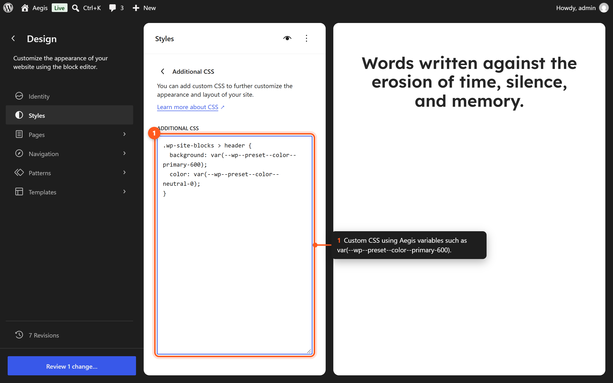

# CSS Variables Reference

This page documents all CSS custom properties (design tokens) generated by the Aegis theme through `theme.json`. These variables are available globally and can be used in custom CSS, block styles, and plugin stylesheets.

## Color Variables

### Primary

```css
--wp--preset--color--primary-25
--wp--preset--color--primary-50
--wp--preset--color--primary-100
--wp--preset--color--primary-200
--wp--preset--color--primary-300
--wp--preset--color--primary-400
--wp--preset--color--primary-500
--wp--preset--color--primary-600
--wp--preset--color--primary-700
--wp--preset--color--primary-800
--wp--preset--color--primary-900
--wp--preset--color--primary-950
```

### Neutral

```css
--wp--preset--color--neutral-0
--wp--preset--color--neutral-50
--wp--preset--color--neutral-100
--wp--preset--color--neutral-200
--wp--preset--color--neutral-300
--wp--preset--color--neutral-400
--wp--preset--color--neutral-500
--wp--preset--color--neutral-600
--wp--preset--color--neutral-700
--wp--preset--color--neutral-800
--wp--preset--color--neutral-900
--wp--preset--color--neutral-950
```

### Info (Blue)

```css
--wp--preset--color--info-100
--wp--preset--color--info-500
--wp--preset--color--info-600
```

### Success (Green)

```css
--wp--preset--color--success-100
--wp--preset--color--success-500
--wp--preset--color--success-600
```

### Warning (Orange)

```css
--wp--preset--color--warning-100
--wp--preset--color--warning-500
--wp--preset--color--warning-600
```

### Error (Red)

```css
--wp--preset--color--error-100
--wp--preset--color--error-500
--wp--preset--color--error-600
```

### Utility Colors

```css
--wp--preset--color--transparent
--wp--preset--color--current
--wp--preset--color--inherit
--wp--preset--color--shadow
```

> There is no `secondary-*`, `tertiary-*`, or `quaternary-*` palette. Semantic Success / Info / Warning / Error each ship only `100`, `500`, and `600`. Default buttons use `primary-900` / `primary-800`. The block style `is-style-secondary` is a button variation name, not a color family.

## Font Family Variables

```css
--wp--preset--font-family--lexend
--wp--preset--font-family--lexend-deca
--wp--preset--font-family--jetbrains
```

## Font Size Variables

```css
--wp--preset--font-size--96                 /* 56px–96px */
--wp--preset--font-size--88                 /* 52px–88px */
--wp--preset--font-size--80                 /* 48px–80px */
--wp--preset--font-size--72                 /* 44px–72px */
--wp--preset--font-size--64                 /* 40px–64px */
--wp--preset--font-size--60                 /* 38px–60px */
--wp--preset--font-size--56                 /* 37px–56px */
--wp--preset--font-size--52                 /* 36px–52px */
--wp--preset--font-size--48                 /* 34px–48px */
--wp--preset--font-size--44                 /* 32px–44px */
--wp--preset--font-size--42                 /* 31px–42px */
--wp--preset--font-size--40                 /* 30px–40px */
--wp--preset--font-size--36                 /* 28px–36px */
--wp--preset--font-size--32                 /* 28px–32px */
--wp--preset--font-size--28                 /* 24px–28px */
--wp--preset--font-size--24                 /* 22px–24px */
--wp--preset--font-size--22                 /* 20px–22px */
--wp--preset--font-size--20                 /* 19px–20px */
--wp--preset--font-size--18                 /* 17px–18px */
--wp--preset--font-size--16                 /* 15px–16px */
--wp--preset--font-size--15                 /* 14px–15px */
--wp--preset--font-size--14                 /* 13px–14px */
--wp--preset--font-size--13                 /* 12px–13px */
--wp--preset--font-size--12                 /* 11px–12px */
--wp--preset--font-size--11                 /* 10px–11px */
--wp--preset--font-size--10                 /* 9px–10px */
--wp--preset--font-size--8                  /* 7px–8px */
--wp--preset--font-size--inherit            /* inherit */
```

Each size is a `clamp()` from the mobile minimum to the named maximum. `inherit` takes the parent's size.

## Spacing Variables

```css
--wp--preset--spacing--xxxs                 /* 4px */
--wp--preset--spacing--xxs                  /* 8px */
--wp--preset--spacing--2-xs                 /* 12px */
--wp--preset--spacing--xs                   /* 16px */
--wp--preset--spacing--sm                   /* 20px–24px */
--wp--preset--spacing--md                   /* 24px–32px */
--wp--preset--spacing--ml                   /* 24px–40px */
--wp--preset--spacing--lg                   /* 24px–48px */
--wp--preset--spacing--xl                   /* 40px–64px */
--wp--preset--spacing--xll                  /* 48px–80px */
--wp--preset--spacing--xxl                  /* 56px–96px */
```

There are no `2xl`, `3xl`, or `4xl` spacing slugs. The `2xs` slug becomes `2-xs` in the variable name.

## Shadow Variables

```css
--wp--preset--shadow--none
--wp--preset--shadow--xxs
--wp--preset--shadow--xs
--wp--preset--shadow--sm
--wp--preset--shadow--md
--wp--preset--shadow--lg
--wp--preset--shadow--xl
--wp--preset--shadow--xxl
```

Every preset is built from `var(--wp--custom--box-shadow--color)`. See [[shadows]] for the values.

## Gradient Variables

```css
--wp--preset--gradient--primary-700-500
--wp--preset--gradient--primary-500-300
--wp--preset--gradient--primary-transparent
--wp--preset--gradient--primary-foreground
--wp--preset--gradient--body-heading
--wp--preset--gradient--surface-border
--wp--preset--gradient--background-transparent
--wp--preset--gradient--transparent-background
--wp--preset--gradient--fade-left
--wp--preset--gradient--fade-right
--wp--preset--gradient--checkerboard
--wp--preset--gradient--grid
--wp--preset--gradient--diagonal-cut-dark-left
--wp--preset--gradient--diagonal-cut-dark-right
--wp--preset--gradient--diagonal-cut-light-left
--wp--preset--gradient--diagonal-cut-light-right
--wp--preset--gradient--fade-dark-top
--wp--preset--gradient--fade-dark-bottom
--wp--preset--gradient--long-top-short-bottom
--wp--preset--gradient--short-top-long-bottom
--wp--preset--gradient--vignette-vertical
--wp--preset--gradient--vignette-radial
--wp--preset--gradient--diagonal-vignette
--wp--preset--gradient--scrim-bottom
--wp--preset--gradient--scrim-top
--wp--preset--gradient--diagonal-triple
--wp--preset--gradient--layered-bands
--wp--preset--gradient--spotlight-bottom-left
--wp--preset--gradient--spotlight-top-right
--wp--preset--gradient--cinematic-bars
--wp--preset--gradient--diagonal-stripes
```

## Layout Variables

```css
--wp--style--global--content-size           /* min(calc(100% - lg * 2), 720px) */
--wp--style--global--wide-size              /* min(calc(100% - lg * 2), 1200px) */
--wp--style--root--padding-left             /* var(--wp--preset--spacing--lg) */
--wp--style--root--padding-right            /* var(--wp--preset--spacing--lg) */
--wp--style--block-gap                      /* var(--wp--preset--spacing--sm) */
```

## Custom Variables

These are custom properties defined in the `custom` section of `theme.json`:

### Border

```css
--wp--custom--border--width                 /* 1px */
--wp--custom--border--style                 /* solid */
--wp--custom--border--color                 /* var(--wp--preset--color--neutral-200) */
--wp--custom--border--radius                /* 6px */
```

### Box Shadow

```css
--wp--custom--box-shadow--x                 /* 0 */
--wp--custom--box-shadow--y                 /* 4px */
--wp--custom--box-shadow--blur              /* 16px */
--wp--custom--box-shadow--spread            /* 0 */
--wp--custom--box-shadow--color             /* var(--wp--preset--color--shadow) */
--wp--custom--box-shadow--hover--y          /* 8px */
```

`--wp--custom--box-shadow--color` is the color every shadow preset uses.

### Font Weight

```css
--wp--custom--font-weight--black            /* 900 */
--wp--custom--font-weight--extrabold        /* 800 */
--wp--custom--font-weight--bold             /* 700 */
--wp--custom--font-weight--semibold         /* 600 */
--wp--custom--font-weight--medium           /* 500 */
--wp--custom--font-weight--normal           /* 400 */
--wp--custom--font-weight--light            /* 300 */
--wp--custom--font-weight--extralight       /* 200 */
--wp--custom--font-weight--thin             /* 100 */
```

### Transition

```css
--wp--custom--transition--property          /* all */
--wp--custom--transition--duration          /* 0.1s */
--wp--custom--transition--timing-function   /* ease-in */
```

### Spacing

```css
--wp--custom--spacing--gap                  /* var(--wp--style--block-gap) */
```

Other `settings.custom` groups (`surface`, `card`, `button`, `input`, `notice`, `callout`, `accordion`, `submenu`, `header`, `icon`, and more) style framework components. Their full names follow the same pattern; see `theme.json`.

There is no `--wp--custom--typography--*` group. Heading and body line heights are set directly in `styles` (body 1.6, headings 1.4, with per-level line heights from the size scale). See [[typography]].

## Using Variables in Custom CSS

### In the Site Editor



*Use Aegis CSS variables in Additional CSS.*

1. Navigate to **Appearance → Editor → Styles**.
2. Click the Options menu (three dots).
3. Select **Additional CSS**.
4. Use CSS custom properties in your rules:

```css
.my-class {
    color: var(--wp--preset--color--primary-700);
    font-family: var(--wp--preset--font-family--lexend);
    font-size: var(--wp--preset--font-size--18);
    padding: var(--wp--preset--spacing--md);
    box-shadow: var(--wp--preset--shadow--sm);
    border-radius: var(--wp--custom--border--radius);
}
```

### In Theme Stylesheets

Block and component stylesheets should always reference design tokens:

```css
/* Good — uses design tokens */
.wp-block-aegis-countdown {
    background: var(--wp--preset--color--neutral-50);
    border: 1px solid var(--wp--preset--color--neutral-200);
    border-radius: var(--wp--custom--border--radius);
    padding: var(--wp--preset--spacing--lg);
}

/* Avoid — hardcoded values */
.wp-block-aegis-countdown {
    background: #fafafa;
    border: 1px solid #e5e5e5;
    border-radius: 6px;
    padding: 32px;
}
```

Using tokens ensures components automatically adapt to style variations and dark mode.

## Variable Naming Convention

WordPress generates CSS custom property names from `theme.json` using this pattern:

```
--wp--preset--{category}--{slug}
--wp--custom--{path}--{property}
--wp--style--{scope}--{property}
```

| Prefix | Source |
|--------|--------|
| `--wp--preset--color--` | `settings.color.palette` |
| `--wp--preset--font-size--` | `settings.typography.fontSizes` |
| `--wp--preset--font-family--` | `settings.typography.fontFamilies` |
| `--wp--preset--spacing--` | `settings.spacing.spacingSizes` |
| `--wp--preset--shadow--` | `settings.shadow.presets` |
| `--wp--preset--gradient--` | `settings.color.gradients` |
| `--wp--custom--` | `settings.custom` |

## Related Pages

- [[color-palette]] — Color token details and usage.
- [[typography]] — Font size and family details.
- [[spacing]] — Spacing scale details.
- [[shadows]] — Shadow preset details.
- [[gradients]] — Gradient preset details.
- [[borders]] — Border token details.
