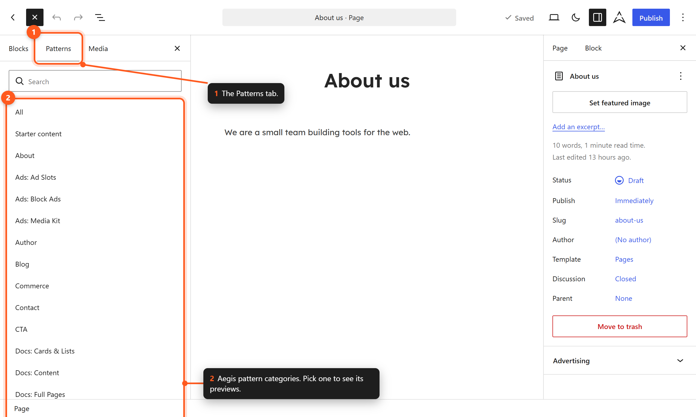
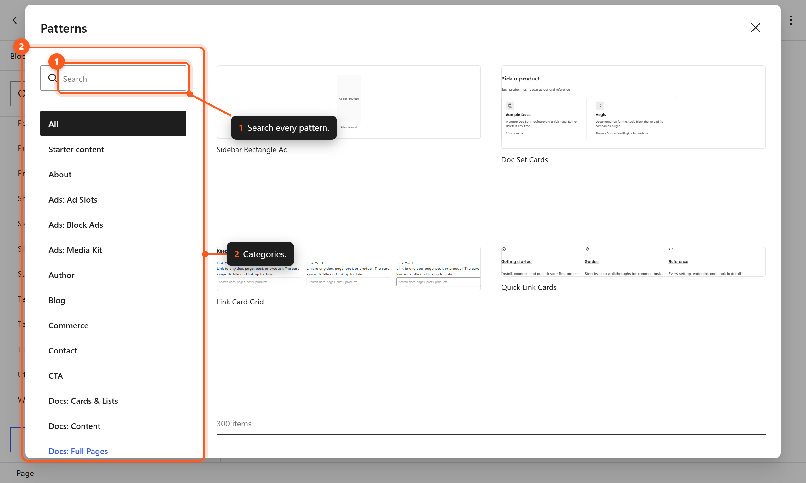
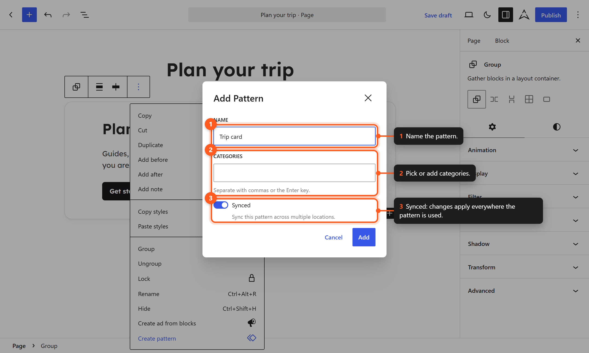

# Block Patterns

Aegis ships with **234 theme block patterns** in **28 category folders**. Companion **plugin** patterns (Modal starters when Modal is enabled; WooCommerce patterns when WooCommerce is active) and **Pro** premium patterns are documented separately — [Plugin Patterns](../../../../plugins/aegis/docs/features/plugin-patterns.md) · [Pro Patterns](../../../../plugins/aegis-pro/docs/patterns/pro-patterns.md).

## Understanding Block Patterns

A block pattern is a pre-arranged group of blocks that forms a complete section or layout component. Patterns accelerate page building by providing professionally designed starting points that you can modify freely after insertion.

## Inserting a Pattern

### From the Block Inserter



*Browse Aegis patterns by category in the block inserter.*

1. Click the **Block Inserter** (+) in the top toolbar of the editor.
2. Switch to the **Patterns** tab.
3. Browse the categories in the dropdown or search by keyword.
4. Click a pattern to insert it at the current cursor position.

### From the Slash Command

1. Type `/` in an empty block to open the quick inserter.
2. Start typing a pattern name or keyword.
3. Select the pattern from the results.

### From the Pattern Explorer



*The pattern explorer shows larger previews.*

1. In the Patterns tab of the block inserter, click **Explore all patterns**.
2. Browse the full-screen pattern explorer with previews.
3. Click a pattern to insert it.

## Pattern Categories

Theme patterns live in **28** `patterns/` category folders:

| Category | Description | Typical Use |
|----------|-------------|-------------|
| About | About sections and pages | Company info, bios |
| Author | Author profile and bio layouts | Blog author pages |
| Blog | Blog listing and post layouts | Blog pages, post grids |
| Commerce | E-commerce product sections | Shop pages, product highlights |
| Contact | Contact forms and information | Contact pages, footer sections |
| CTA | Call-to-action sections | Conversion sections |
| Event | Event listings and details | Event pages, calendars |
| FAQ | Frequently asked questions | Support pages |
| Featured | Feature showcases and grids | Product features, services |
| Footer | Footer layouts | Site footers |
| Header | Header layouts | Site headers |
| Hero | Hero banners and landing sections | Page headers, landing pages |
| Hidden | 404 page layouts, not shown in the inserter | 404 template |
| Logos | Logo grids and client showcases | Trust signals, partnerships |
| Newsletter | Email signup sections | Lead generation |
| Notice | Alert and notification banners | Announcements, warnings |
| Pages | Full page layouts | Complete page designs |
| Portfolio | Portfolio and project showcases | Creative portfolios |
| Pricing | Pricing tables and comparisons | SaaS, service pricing |
| Product | Product detail sections | Product showcases |
| Sidebar | Sidebar / complementary layouts | Blog sidebars, template parts |
| Slider | Carousel and slider layouts | Image galleries, testimonials |
| Stats | Statistics and number highlights | Achievement sections |
| Team | Team member grids and profiles | About pages |
| Template | One layout per template file, not shown in the inserter | Template building |
| Testimonial | Reviews and testimonial sections | Social proof |
| Timeline | Chronological content layouts | Company history, roadmaps |
| Utility | Color palette, gradients, dark mode toggle, search toggle, skip link | Layout utilities |

Related Posts layouts (`blog-related-posts-grid`, `list`, `cards`, `minimal`) are in the **Blog** category. They unregister when **Aegis → Blocks → Related Posts** is implied off. See [Related Posts Block](../blocks/related-posts.md).

**Modal** patterns (`aegis/modal-*`) are registered by the [Aegis companion plugin](../../../../plugins/aegis/docs/features/plugin-patterns.md) when the Modal block is enabled — they are not theme patterns.

## Customizing Patterns After Insertion

Once inserted, a pattern becomes regular blocks that you can fully customize:

- **Change text** — Click any text and edit directly.
- **Replace images** — Click an image and use the toolbar to replace it.
- **Modify colors** — Select a block and change its color settings in the sidebar.
- **Adjust spacing** — Use the block spacing controls to change padding and margins.
- **Rearrange blocks** — Drag blocks to reorder them within the pattern.
- **Remove blocks** — Delete any block you do not need.
- **Add blocks** — Insert additional blocks into the pattern structure.

## Pattern Design Principles

All Aegis patterns are built following these principles:

- **Responsive** — Every pattern adapts gracefully from mobile to desktop viewports.
- **Accessible** — Patterns use semantic markup, proper heading hierarchy, and ARIA attributes where needed.
- **Theme-aware** — Patterns use design tokens (CSS custom properties) from `theme.json`, so they automatically adapt to style variations.
- **Lightweight (theme patterns)** — Theme-owned patterns use core blocks and Aegis custom blocks only, with no external dependencies. WooCommerce block patterns (plugin-owned) use `wp:woocommerce/*` blocks when WooCommerce is active.

## Hidden Patterns

52 theme patterns do not appear in the block inserter: the 3 **Hidden** patterns (404 layouts), the 48 **Template** patterns that the files in `templates/` load, and `utility-patterns`. They set `Inserter: false` in their file header (the `hidden` category is also excluded automatically). Templates and other patterns still reference them by slug, for example `<!-- wp:pattern {"slug":"template-single"} /-->`.

## WooCommerce Patterns

WooCommerce **block patterns** (product grids, store headers, checkout/cart template patterns, etc.) need WooCommerce. When WooCommerce is active, the **Aegis companion plugin** registers its store versions of these patterns.

Without WooCommerce, the theme keeps them out of the editor so it never shows "unsupported block" placeholders:

- Header patterns stay available with the cart and account icons removed.
- Other patterns built on WooCommerce blocks (shop, product, cart, checkout, and order layouts) are hidden.
- The same applies to patterns that use a block from the Aegis plugin, such as the map in the contact patterns, when the plugin is not active.

This check runs when the editor loads patterns. On the front end, blocks from inactive plugins render as nothing.

The theme still includes generic **Commerce** and **Product** marketing patterns that use core blocks only (for example category cards, trust badges). Patterns with `wp:woocommerce/*` blocks live in the plugin — see [Plugin Patterns](../../../../plugins/aegis/docs/features/plugin-patterns.md).

| Requirement | Patterns available |
|-------------|-------------------|
| Aegis theme only | Generic commerce marketing patterns (core blocks) |
| Theme + Aegis plugin + WooCommerce | Full WooCommerce block pattern library |
| Above + TI WooCommerce Wishlist | Wishlist template pattern (`template-page-wishlist`) |

### Store headers

WC header patterns with mini-cart and customer-account blocks live in the **companion plugin** (`patterns/woocommerce/header/`) and require WooCommerce. The theme's **`header/default`** for `parts/header.html` shows no cart or account icons in the editor when WooCommerce is inactive, and **`header/store-minimal`** for checkout/funnel pages. When WooCommerce is active, the plugin overlays `header-default` with the mini-cart variant.

## Creating Your Own Patterns

### Synced Patterns (formerly Reusable Blocks)



*Save your own blocks as a synced pattern to reuse them across the site.*

1. Select the blocks you want to save as a pattern.
2. Click the **Options** menu (three dots) in the block toolbar.
3. Select **Create pattern**.
4. Name the pattern and optionally assign a category.
5. Choose whether the pattern should be **Synced** (changes propagate everywhere) or **Not synced** (independent copies).

### Registering Custom Patterns (Developers)

Developers can register patterns by creating PHP files in the `patterns/` directory:

```php
<?php
/**
 * Title: My Feature Section
 * Slug: my-feature-section
 * Categories: featured
 * Description: A custom feature section.
 */
?>
<!-- wp:group {"align":"wide"} -->
<div class="wp-block-group alignwide">
    <!-- Block markup here -->
</div>
<!-- /wp:group -->
```

Aegis registers the file under its first category plus the `Slug` header, so this example becomes `featured-my-feature-section`. Files whose names start with a dot are skipped. To keep your own patterns outside the theme folder, register more folders with the `aegis_pattern_dirs` filter from a plugin.

## Browsing Patterns by Page Type

When building specific types of pages, look at these categories:

| Page Type | Recommended Categories |
|-----------|----------------------|
| Homepage | Hero, Featured, Testimonial, CTA, Logos, Stats |
| About Page | About, Team, Timeline, Stats |
| Services | Featured, Pricing, FAQ, CTA |
| Contact | Contact, Newsletter |
| Blog | Blog, Author |
| Portfolio | Portfolio, Slider |
| Shop | Commerce, Product, Pricing |
| Landing Page | Hero, Featured, Testimonial, CTA, Pricing |

## Next Steps

- [[pattern-reference]] — Complete list of all pattern categories with descriptions.
- [[style-variations]] — See how patterns adapt to different style variations.
- [[custom-blocks]] — Learn about the custom blocks used in patterns.
- [[templates]] — Use patterns to build custom templates.
