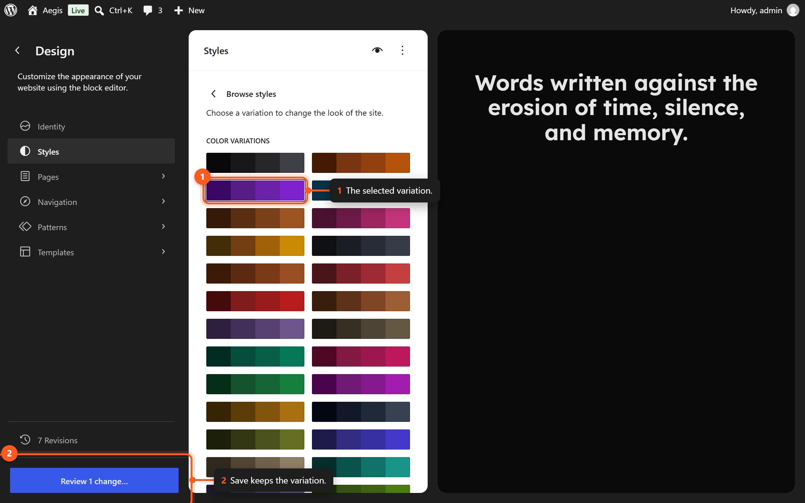
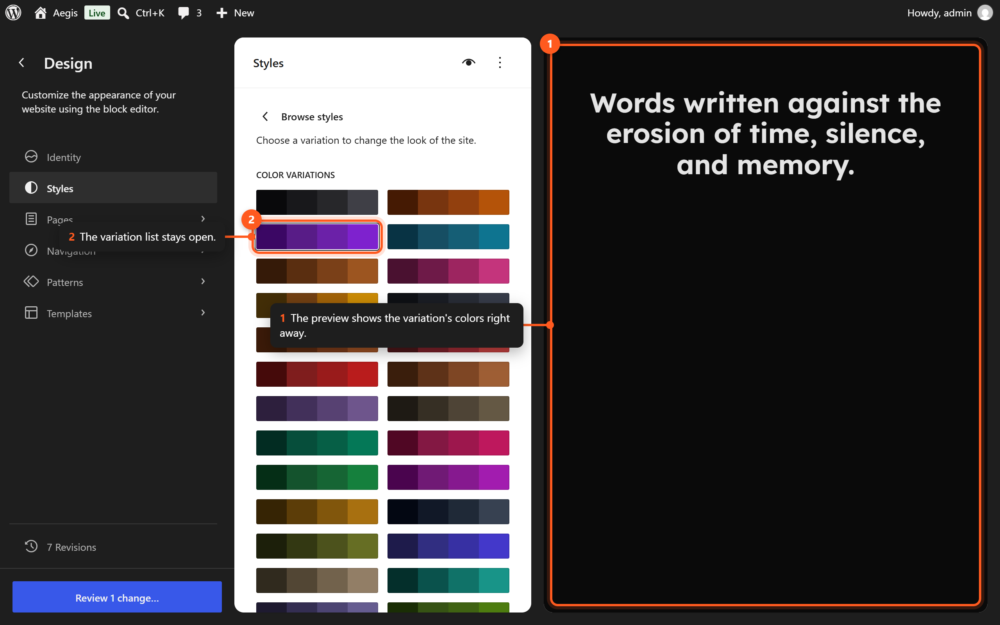

# Style Variations

Aegis includes 60 style variations that allow you to transform the visual appearance of your entire site with a single click. Each variation replaces the color palette. Four of them also set base colors for the page, text, headings, buttons, and links.

## Understanding Style Variations

A style variation is a `theme.json` override that redefines the design tokens for your site. When you apply a variation, all templates, template parts, and patterns automatically adapt to the new color palette without any manual changes. Typography, spacing, and layout tokens stay the same in every variation.

Style variations do not alter your content or layout — they only change the visual presentation.

## Applying a Style Variation



*Click a variation to preview it, then Save to apply it.*

1. Navigate to **Appearance → Editor** to open the Site Editor.
2. Click the **Styles** icon (half-filled circle) in the top toolbar.
3. Click **Browse styles**.
4. Scroll through the grid of available variations.
5. Click a variation to preview it on your site.
6. Click **Save** to apply the variation.

## Available Variations

Aegis ships with 60 style variations organized alphabetically:

| # | Variation | Primary Mood |
|---|-----------|--------------|
| 1 | Amber | Warm golden tones |
| 2 | Amethyst | Rich purple elegance |
| 3 | Arctic | Cool icy blues |
| 4 | Autumn | Warm fall palette |
| 5 | Blossom | Soft pink florals |
| 6 | Canary | Bright cheerful yellow |
| 7 | Charcoal | Deep dark grays |
| 8 | Copper | Warm metallic earth |
| 9 | Coral | Vibrant warm pink-orange |
| 10 | Crimson | Bold deep red |
| 11 | Desert | Sandy warm neutrals |
| 12 | Dusk | Evening twilight hues |
| 13 | Earth | Natural brown tones |
| 14 | Emerald | Rich green jewel |
| 15 | Flamingo | Playful bright pink |
| 16 | Forest | Deep natural greens |
| 17 | Fuchsia | Vivid magenta-pink |
| 18 | Gilded | Luxurious gold accents |
| 19 | Grayscale | Pure monochromatic |
| 20 | Grove | Fresh green nature |
| 21 | Indigo | Deep blue-violet |
| 22 | Ivory | Clean off-white elegance |
| 23 | Lagoon | Tropical blue-green |
| 24 | Lavender | Soft purple calm |
| 25 | Lime | Energetic yellow-green |
| 26 | Linen | Warm neutral fabric |
| 27 | Marigold | Bright orange-yellow |
| 28 | Midnight | Dark navy blue |
| 29 | Mist | Light airy gray |
| 30 | Moss | Muted olive green |
| 31 | Neon | Electric vivid colors |
| 32 | Neutral | Balanced gray palette |
| 33 | Obsidian | Pure dark black |
| 34 | Ocean | Deep sea blue |
| 35 | Orchid | Exotic purple-pink |
| 36 | Parchment | Aged paper warmth |
| 37 | Peach | Soft warm orange |
| 38 | Pewter | Cool silver-gray |
| 39 | Plum | Dark rich purple |
| 40 | Raspberry | Bold berry red-pink |
| 41 | Rose | Classic soft pink |
| 42 | Rustic | Weathered earth tones |
| 43 | Sage | Muted green calm |
| 44 | Sand | Warm desert beige |
| 45 | Sapphire | Brilliant deep blue |
| 46 | Sepia | Vintage warm brown |
| 47 | Sky | Light cheerful blue |
| 48 | Slate | Cool blue-gray |
| 49 | Steel | Industrial cool gray |
| 50 | Stone | Neutral warm gray |
| 51 | Sunflower | Bright warm yellow |
| 52 | Tangerine | Vibrant orange |
| 53 | Tea | Warm muted green |
| 54 | Teal | Blue-green balance |
| 55 | Terracotta | Warm clay earth |
| 56 | Vintage | Retro muted palette |
| 57 | Violet | Classic purple |
| 58 | Walnut | Rich dark brown |
| 59 | Wine | Deep burgundy red |
| 60 | Zinc | Cool gray on a dark background |

## What Each Variation Changes

Every variation file in `styles/` sets `settings.color.palette`: the primary, neutral, and status shades. Because every block, pattern, and template uses palette tokens, the whole site follows the new palette.

Four variations also set `styles`:

- **Midnight, Obsidian, and Zinc** use a dark default background (`primary-950`), light text (`neutral-300`), light headings (`neutral-100`), and lighter buttons and links.
- **Flamingo** sets its own text, heading, button, and link-hover colors on the white background.

No variation changes fonts, font sizes, spacing, or layout.

## Customizing After Applying a Variation

After applying a style variation, you can further customize individual settings:

1. With the variation active, click the **Styles** icon.
2. Navigate to **Typography**, **Colors**, or **Layout**.
3. Adjust any specific token or element style.
4. Save your changes.

Your customizations layer on top of the variation. If you later switch to a different variation, your manual overrides may be replaced.

## Previewing Variations

You can preview any variation without committing to it:



*Variations preview live in the canvas before you save.*

1. Open the style browser in the Site Editor.
2. Click a variation — the canvas updates immediately.
3. Navigate through your site pages to see the effect on different layouts.
4. If you do not like it, select a different variation or close without saving.

## Reverting to the Default Variation

To return to the default Aegis style (the theme's own `theme.json`, titled **Light**):

1. Open the Styles panel in the Site Editor.
2. Click **Browse styles**.
3. Select the first style in the list (the base `theme.json` styles).
4. Click **Save**.

Alternatively, to reset all style customizations:

1. Open the Styles panel.
2. Click the **Options** menu (three dots).
3. Select **Reset to defaults**.

## How Variations Work Technically

Style variations are stored as JSON files in the `styles/` directory of the theme:

```
styles/
├── amber.json
├── amethyst.json
├── arctic.json
├── ...
└── zinc.json
```

Each file contains a partial `theme.json` structure that overrides specific settings from the base `theme.json`.

## Creating Custom Variations (Advanced)

While you cannot create new style variations through the Site Editor interface, developers can add custom variations:

1. Create a new JSON file in the `styles/` directory.
2. Define the `title` and any `settings` or `styles` overrides.
3. The variation will appear automatically in the style browser.

See the [[css-variables-reference]] for the full list of design tokens available for customization.

## Next Steps

- [[style-variations-reference]] — Complete alphabetical listing of all 60 variations.
- [[global-styles]] — Fine-tune settings beyond the variation defaults.
- [[color-palette]] — Understand the color system used in variations.
- [[typography]] — Learn about the typographic scale.
