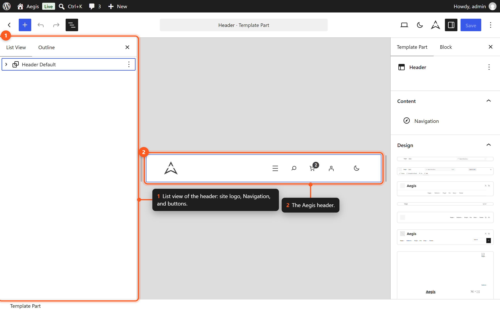
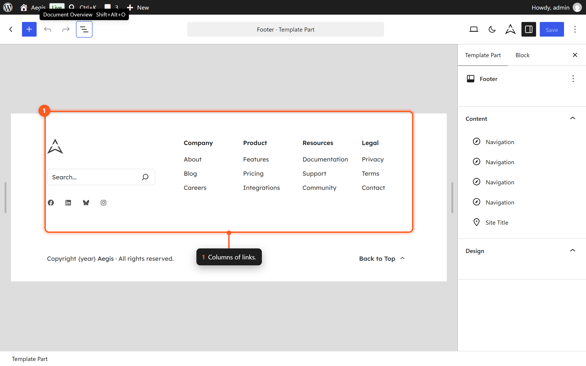
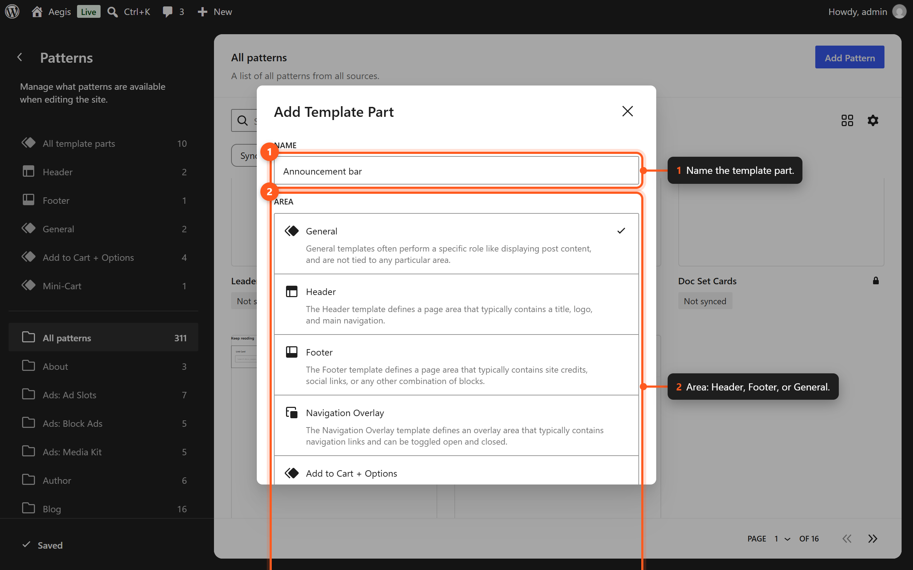

# Template Parts

Template parts are reusable sections of a template that appear consistently across multiple pages. Aegis includes three template parts: Header, Footer, and Sidebar.

## Understanding Template Parts

In a block theme, template parts function like building blocks for templates. Rather than repeating the same header or footer markup in every template file, you define it once as a template part and reference it from any template that needs it.

Template parts are stored in the `parts/` directory of the theme and are editable through the Site Editor.

## Available Template Parts

| Part | Filename | Description |
|------|----------|-------------|
| Header | `parts/header.html` | The site header containing logo, navigation, and utility elements. |
| Footer | `parts/footer.html` | The site footer containing copyright, links, and secondary navigation. |
| Sidebar | `parts/sidebar.html` | An optional sidebar for supplementary content and widgets. |

## Header

The default Aegis header includes:

- **Site Logo** — Displayed at the leading edge of the header.
- **Site Title** — The site name, linked to the homepage.
- **Navigation** — The primary navigation menu.
- **Search** — An optional search toggle.
- **Contact** — A button with a mail icon that links to your site's `/contact/` page. It is hidden on phones. Create a page with the slug `contact`, or edit the button's link.
- **Dark Mode Toggle** — An optional button to switch between light and dark modes.

### Header Position

The header scrolls with the page. It has an opaque background, so content never shows through it if you make it sticky.

The behavior comes from `settings.custom.header` in `theme.json`:

| Key | Default | CSS variable |
|-----|---------|--------------|
| `position` | `relative` | `--wp--custom--header--position` |
| `top` | `0px` | `--wp--custom--header--top` |
| `zIndex` | `100` | `--wp--custom--header--z-index` |
| `background` | `var(--wp--preset--color--neutral-0)` | `--wp--custom--header--background` |
| `scrollPadding` | `0px` | `--wp--custom--header--scroll-padding` |

> **Changed in 1.0.2.** Aegis 1.0.1 made the header sticky by default. Version 1.0.2 restored the scrolling header.

#### Make the Header Sticky

Add this to **Styles → Additional CSS** in the Site Editor. It survives theme updates:

```css
body {
	--wp--custom--header--position: sticky;
	--wp--custom--header--top: var(--wp-admin--admin-bar--height, 0px);
	--wp--custom--header--scroll-padding: 5rem;
}
```

On desktop the sticky header sits just below the WordPress admin bar when you are logged in. On phones (600px and narrower) it sticks to the very top, because the admin bar scrolls away there. `scrollPadding` keeps in-page links and keyboard focus from landing under the header; raise it if your header is taller than 80px.

A header given its own position in the block settings (a `has-position-*` class) keeps that setting instead.

### Editing the Header



*Edit the header from Patterns → Template parts → Header.*

1. Navigate to **Appearance → Editor**.
2. Click **Patterns** in the left sidebar.
3. Select **Template Parts**.
4. Click **Header** to open it in the editor.
5. Make your changes and click **Save**.

### Common Header Customizations

| Task | Instructions |
|------|--------------|
| Change the logo | Click the Site Logo block and replace the image. |
| Edit navigation items | Click the Navigation block and use the toolbar to add or remove items. |
| Hide the search icon | Select the Search block and remove it. |
| Change the Contact link | Select the Contact button and edit its link. |
| Add a CTA button | Insert a Buttons block after the Navigation block. |
| Change header width | Select the outer Group block and adjust alignment (wide or full). |

## Footer

The default Aegis footer includes:

- **Widget columns** — Organized in a multi-column layout for links and information.
- **Copyright text** — Site title and current year.
- **Secondary navigation** — Links to privacy policy, terms, and other pages.
- **Social icons** — Links to social media profiles.

### Editing the Footer



*The footer template part in the Site Editor.*

1. Navigate to **Appearance → Editor**.
2. Click **Patterns** in the left sidebar.
3. Select **Template Parts**.
4. Click **Footer** to open it in the editor.
5. Make your changes and click **Save**.

### Common Footer Customizations

| Task | Instructions |
|------|--------------|
| Update copyright text | Edit the Paragraph block containing the copyright notice. |
| Add social links | Insert a Social Icons block and configure your profiles. |
| Change column count | Adjust the Columns block layout (2, 3, or 4 columns). |
| Add a newsletter form | Insert a newsletter pattern from the Newsletter category. |

### Empty Footer Navigation

A Navigation block with no menu assigned normally falls back to a list of **every** published page. On sites with many pages (or with bbPress forums), that fallback made the footer grow out of control.

Since 1.0.1, the theme (`src/NavigationFallback.php`) replaces that page-list fallback with a short sample menu: **Home**, **Blog** (`/blog/`), **About** (`/about/`), and **Contact** (`/contact/`). This applies to any Navigation block whose fallback would be only a Page List, in the header as well as the footer.

To show your own links, select the Navigation block and choose or create a menu. Once a menu is assigned, the sample links no longer appear.

## Sidebar

The sidebar template part provides supplementary content alongside the main content area. It is not included in all templates by default.

The default Aegis sidebar includes:

- **Search** — A search form for site content.
- **Recent Posts** — A list of the latest published posts.
- **Categories** — Post category navigation.
- **Tags** — A tag cloud or list.

### Editing the Sidebar

1. Navigate to **Appearance → Editor**.
2. Click **Patterns** in the left sidebar.
3. Select **Template Parts**.
4. Click **Sidebar** to open it in the editor.
5. Make your changes and click **Save**.

### Using the Sidebar in Templates

To add a sidebar to a template that does not currently have one:

1. Open the template in the Site Editor.
2. Wrap the main content area in a **Columns** block (for example, 2/3 + 1/3 layout).
3. In the narrower column, insert a **Template Part** block.
4. Select the **Sidebar** template part from the dropdown.
5. Save the template.

To remove a sidebar from a template, delete the Template Part block referencing the sidebar.

## Creating Custom Template Parts

You can create additional template parts for specialized needs:



*Create a template part and choose the area it belongs to.*

1. In the Site Editor, go to **Patterns → Template Parts**.
2. Click the **+** button to add a new template part.
3. Choose an area designation (Header, Footer, or General).
4. Build the layout using blocks.
5. Save the template part.
6. Reference the new part in any template by inserting a Template Part block.

## Template Part Areas

WordPress defines three template part areas:

| Area | Purpose | Usage |
|------|---------|-------|
| Header | Top of the page | Site branding, navigation |
| Footer | Bottom of the page | Copyright, secondary links |
| General | Anywhere in the template | Sidebars, banners, and other reusable sections |

The area designation helps WordPress organize parts in the editor interface and determines where they can be selected from the template part picker.

## Overriding Template Parts per Template

If you need a different header or footer for a specific template:

1. Open the target template in the Site Editor.
2. Click on the existing Template Part block (for example, the header).
3. In the block toolbar, click **Replace**.
4. Select a different template part, or choose **Start blank** to build a custom section directly in that template.

This override only affects the current template; other templates continue using the original part.

## Loading Parts Contextually

To swap header, footer, or sidebar based on page context without duplicating templates, use Aegis’s `aegis_dynamic_template_part_slug` filter. See [[dynamic-template-parts]] for examples (category sidebars, landing headers, checkout footers).

## Reverting Template Parts

To restore a template part to its original state:

1. Navigate to **Patterns → Template Parts** in the Site Editor.
2. Select the modified template part.
3. Open the **Options** menu (three dots).
4. Click **Clear customizations**.

This removes all your changes and restores the version that shipped with Aegis.

## Next Steps

- [[templates]] — See how template parts are used within templates.
- [[site-editor]] — Learn more about editing in the Site Editor.
- [[block-patterns]] — Explore patterns you can use within template parts.
